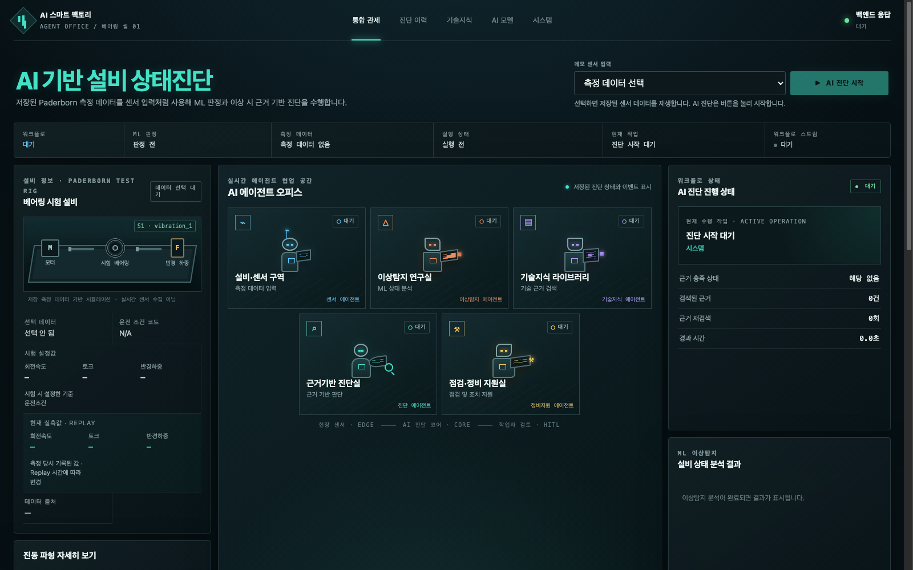
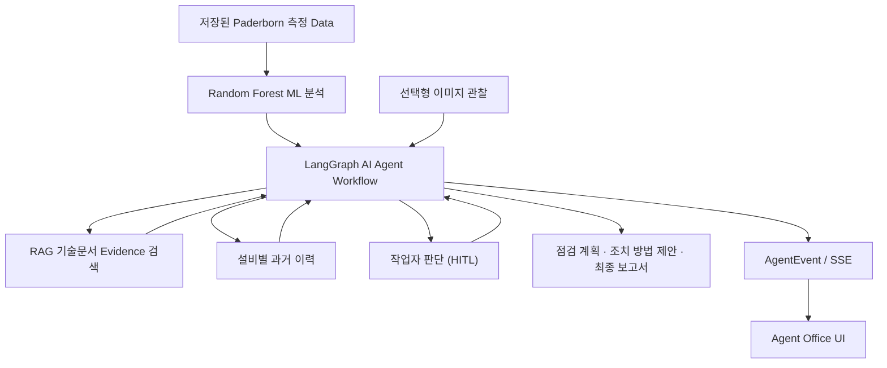

# AI Smart Factory Agent Office

Paderborn University Bearing DataCenter의 저장된 Bearing 측정 Data를 ML로 분석해
Bearing의 정상·이상 상태를 판별합니다. ML이 Bearing에 이상이 있다고 판정하면, RAG가
관련 기술문서를 검색합니다. AI Agent가 근거가 충분한지 확인하고, 이상 판별 시 원인을
진단한 뒤 추가 점검이 필요한 항목에 대한 점검 계획을 수립합니다. 작업자에게 조치 방법을 제안하고 최종
보고서를 생성합니다.
중요한 결정은 작업자가 하도록 지원하는 근거 기반 AI Agent MVP(최소 기능 제품)입니다.

현재는 Paderborn University Bearing DataCenter에서 저장된 Bearing의 측정 결과를
불러오고, 선택한 측정 Data의 저장 신호를 해당 측정의 시간축에 따라 순차적으로
재생(Replay)합니다. 측정 Data에는 진동, 전류, 회전속도, 토크(Torque), 힘, 온도
관련 메타데이터가 포함되며, 현재 ML 입력은 진동 1개 채널과 전류 2개 채널에서
추출한 36개 특징값입니다. 현재는 실제 공장 Sensor에서 진동·전류·회전속도·토크(Torque)
등의 상태 Data를 실시간으로 수집·수신하지 않습니다.



### Service 시연(Live Demo)

[https://factory.aipath.kr](https://factory.aipath.kr)

> 심사 및 검증을 위한 외부 접속 주소입니다.

## 빠른 탐색

- [AI Native Final Project 제출 산출물](#ai-native-final-project-제출-산출물)
- [문제 정의](#문제-정의)
- [해결 방식](#해결-방식)
- [대표 입력 Data와 검증 경로](#대표-입력-data와-검증-경로)
- [Data·ML·RAG](#데이터)
- [작업자 판단(HITL)과 안전](#작업자-판단hitl과-안전)
- [시스템 구조 (Architecture)](#시스템-구조-architecture)
- [테스트 결과](#테스트-결과)
- [현재 개발 상태](#현재-개발-상태)
- [KAMP 확장 가능성 검증](#kamp-확장-가능성-검증-개념-검증poc)
- [팀 역할](#팀-역할-요약)
- [출처 및 사용 조건](#출처-및-사용-조건)

## AI Native Final Project 제출 산출물

| 번호 | 제출 산출물 | 내용 | 링크 |
|---|---|---|---|
| ① | 프로젝트 기획서 | 문제 정의, 목표, AI 활용 방식 및 추진 계획 | 별도 제출 파일 |
| ② | 기능 요구 명세서 | 기능·비기능 요구사항, 시스템 구조 (Architecture), AI 활용 명세 및 RTM | 별도 제출 파일 |
| ③ | 배포 URL | 실제 서비스 접속 및 기능 시연 | [Service 시연(Live Demo)](https://factory.aipath.kr) |
| ④ | GitHub 저장소 URL | 소스코드, 구현 구조 및 개발 결과 | [LSH97ND GitHub 저장소](https://github.com/lsh97nd-code/AI-Smart-Factory-Agent-Office) |
| ⑤ | 사용자 feedback 기록 | Google Forms 설문 분석 및 feedback 기반 UI 개선 결과 | 별도 제출 파일 |
| ⑥ | 서면 심사용 발표자료 | 프로젝트 주요 성과와 AI 기술 활용 및 사용자 검증 결과 | 별도 제출 파일 |
| ⑦ | 시연영상 | 주요 기능과 AI 작업 흐름 시연(3분 이내) | 별도 제출 파일 |

### 평가자 안내

- **서비스 접속:** [Service 시연(Live Demo)](https://factory.aipath.kr)
- **소스코드:** [LSH97ND GitHub 저장소](https://github.com/lsh97nd-code/AI-Smart-Factory-Agent-Office)
- **시스템 요약:** 선택한 저장 측정 Data의 신호를 시간축에 따라 재생하고, 진동 1개 채널과 전류 2개 채널에서 추출한 36개 특징값으로 정상·이상을 판별합니다. 이상으로 판정되면 RAG가 기술문서를 검색하고, AI Agent가 근거가 충분한지 확인하고 이상 판별 시 원인을 진단한 뒤 추가 점검이 필요한 항목에 대해 점검 계획을 세우고, 작업자에게 조치 방법을 제안한 후 최종 보고서를 생성합니다.
- **사용자 검증:** 외부에 Service를 제공하고 사용자로부터 feedback을 받았으며, feedback을 반영해 Service를 개선했습니다.
- **안전 범위:** 실제 공장 Sensor Data 실시간 수집·수신, PLC를 통한 설비 직접 제어, 설비 자동 정지, 자동 정비 실행은 포함하지 않습니다.

### AI Native Final Project(전문가 평가 요청 대상 과제물)의 평가자료 및 참고자료

- **발표 Script (Markdown, 참고자료):** [`docs/presentation_script.md`](docs/presentation_script.md)
- **시연 흐름 (개발·재현 참고자료):** [`docs/DEMO_SCRIPT.md`](docs/DEMO_SCRIPT.md)

위 자료는 AI Native Final Project(전문가 평가 요청 대상 과제물)의 평가자료와 참고자료입니다.

## 문제 정의

기존에는 제조설비에 이상이 발견되면 담당자가 측정 결과를 확인하고,
기술문서를 찾아 원인을 파악한 뒤 점검 계획을 세우고 정비 여부를 판단해야
합니다. 이 과정이 여러 작업자에게 나뉘어 전달되거나 담당자의 숙련도가
다르면 판단이 달라질 수 있고, 사람이 직접 자료를 찾고 기록해야 해 시간이
걸립니다. 또한 기록이 충분하지 않으면 나중에 어떤 근거로 어떤 판단과 조치를
했는지 추적하기 어렵습니다.

## 해결 방식

AI Smart Factory Agent Office는 Paderborn University Bearing DataCenter에서
저장된 Bearing 측정 Data를 불러오고, 선택한 측정 Data의 신호를 시간축에 따라
재생하면서 진동·전류 Data를 분석해 다음 진단 절차를 하나의 진단 흐름으로 연결합니다.
현재 ML은 진동 1개 채널과 전류 2개 채널에서 추출한 36개 특징값을 이용합니다.

- 선택한 측정 Data의 저장 신호를 해당 측정의 시간축에 따라 재생(Replay)합니다.
- 진동 1개 채널과 전류 2개 채널에서 신호의 크기와 변화 특성을 요약한 총 36개의 특징값을 추출합니다.
- 여러 의사결정나무의 결과를 종합하는 Random Forest로 Bearing의 정상·이상 상태를 판별합니다.
- 정상으로 판정되면 RAG와 후속 진단을 생략하고 정상 보고서를 생성합니다.
- 이상으로 판정되면 RAG(관련 기술문서 검색)가 상태·진동 이상·점검·정비 관련 문서에서 현재 상황과 관련된 내용을 찾아 진단 근거로 제시합니다.
- AI Agent가 근거가 충분한지 확인하고, 이상 판별 시 원인을 진단한 뒤 추가 점검이 필요한 항목에 대한 점검 계획을 수립하고 작업자에게 조치 방법을 제안해 판단을 지원합니다.
- 중요한 결정이 필요하면 작업자에게 판단을 요청하고 Workflow를 대기 상태로 전환합니다. 작업자가 승인·수정 요청·거절 중 하나를 선택하면 AI Agent가 그 결과를 반영해 처음부터 다시 시작하지 않고 저장된 Checkpoint부터 이후 절차를 이어서 실행합니다.
- 최종 보고서와 AI Agent 실행 이력은 실행 기록 저장소에, Checkpoint는 중단 시점의 Workflow 상태 저장소에, 설비 이력은 별도 설비 이력 저장소(SQLite)에 분리해 저장합니다.

## 전체 진단 흐름

```text
저장된 측정 Data 재생
→ 특징값 추출
→ Random Forest로 Bearing 상태 판별
→ 정상: RAG 생략 → 정상 보고서 생성
→ 이상: 관련 기술문서 검색 → 진단 근거 제시
→ AI Agent가 근거가 충분한지 확인
→ 이상 판별 시 원인 진단
→ AI Agent가 추가 점검이 필요한 항목에 대해 점검 계획 수립
→ AI Agent가 작업자에게 조치 방법 제안
→ 필요 시 작업자 판단(HITL): Workflow 대기 → 승인·수정 요청·거절 → Checkpoint 이후부터 재개
→ 최종 보고서 생성
```

위 흐름은 사용자 관점의 설명입니다. 실제 Graph에서는 RAG가 검색한 기술문서 근거를 바탕으로 AI Agent가 1차 이상 원인 진단 결과를 구성한 뒤, AI Agent가 근거가 충분한지 확인합니다. 이후 추가 점검이 필요한 항목에 대한 점검 계획을 수립하고 작업자에게 조치 방법을 제안해 작업자의 판단을 돕습니다.

## 대표 입력 Data와 검증 경로

발표에서는 **A 정상, B 이상, C 작업자 판단(HITL)**의 3가지 대표 시나리오를 사용합니다.

### A. 정상 시나리오

대표 입력은 Paderborn에 저장된 Bearing 측정 Data **`K001`**입니다.

이 시나리오는 ML이 Bearing을 정상으로 판정한 뒤, 불필요한 이상 원인 진단 과정을 생략하고 정상 보고서를 생성하는 흐름을 확인합니다.

```text
K001 측정 Data
→ Random Forest ML 분석
→ normal 판정
→ RAG 검색 및 이상 원인 진단 생략
→ 정상 보고서 생성
→ COMPLETED
```

즉 정상 상태에서는 이상 진단을 위해 불필요하게 RAG 검색과 후속 조치 계획을 수행하지 않는지 확인합니다.

---

### B. 이상 시나리오

대표 입력은 Paderborn에 저장된 Bearing 측정 Data **`KA01`**입니다.

이 시나리오는 ML이 Bearing을 이상으로 판정한 뒤, RAG 기술문서의 근거를 이용하여 이상 원인을 진단하고 점검·조치 방법을 제안하는 전체 흐름을 확인합니다.

```text
KA01 측정 Data
→ Random Forest ML 분석
→ abnormal 판정
→ RAG 기술문서 검색
→ Evidence가 진단에 사용할 수 있는 상태인지 확인
→ Bearing 이상 원인 진단 결과 구성
→ 추가 점검 계획 수립
→ 작업자에게 조치 방법 제안
→ 최종 보고서 생성
→ COMPLETED
```

여기서 AI Agent는 검색 결과가 존재한다는 이유만으로 바로 결론을 확정하지 않고, 검색된 Evidence가 현재 진단에 사용할 수 있는 상태인지 확인한 뒤 다음 단계로 진행합니다.

---

### C. 작업자 판단(HITL) 시나리오

대표 입력은 **`KA01` 측정 Data + 작업자 판단이 필요하도록 설정한 통제된 시연 조건**입니다.

이 시나리오는 AI Agent가 중요한 조치 방법을 자동으로 확정하지 않고, 실제로 Workflow를 멈춘 뒤 작업자의 판단을 기다리고 같은 Run을 이어서 실행하는지 확인합니다.

```text
KA01 측정 Data
→ ML 및 RAG 분석
→ 작업자 검토가 필요한 조치 방법 제안
→ Run = WAITING
→ 작업자에게 근거와 조치 방법 제안 표시
→ 작업자가 승인 / 수정 요청 / 거절
→ 작업자 판단 반영
→ 같은 run_id에서 Checkpoint를 이용해 Workflow 재개
→ 최종 보고서 생성
→ COMPLETED
```

작업자의 선택은 새로운 분석 Run을 만드는 것이 아니라, **기존 Run의 저장된 상태를 이용해 같은 실행을 이어서 처리**합니다.

---

### 발표 시나리오와 내부 검증 시나리오

발표에서는 이해하기 쉽도록 다음 **3개 대표 시나리오**를 사용합니다.

- **A 정상** — 정상 판정 후 이상 진단 경로를 생략하는 흐름
- **B 이상** — RAG Evidence를 활용하여 이상 원인을 진단하고 점검·조치 방법을 제안하는 흐름
- **C 작업자 판단** — HITL을 통해 작업자의 판단을 기다린 뒤 같은 Run을 재개하는 흐름

내부 통합 검증에서는 여기에 **RAG Evidence가 부족하거나 충돌할 때 Query를 보완하여 다시 검색하는 Retry(재검색) 경로**를 추가하여 총 4가지 대표 흐름을 확인합니다.

> **C 시나리오의 통제 조건에 대한 주의사항**  
> C 시나리오에서 사용하는 통제 조건은 Random Forest의 Bearing 정상·이상 판정을 임의로 변경하거나 RAG 기술문서의 내용을 바꾸는 것이 아닙니다.  
> 실제 ML·RAG 분석을 수행한 뒤 **작업자 판단(HITL) 경로를 확실하게 시연·검증할 수 있도록 조치 조건을 통제하는 방식**입니다. 따라서 이 시나리오는 HITL Workflow 동작을 확인하기 위한 것이며, 실제 현장 위험 감지 성능을 증명하는 자료로 사용하지 않습니다.

### 핵심 용어

- **ML(Machine Learning):** 진동 1개 채널과 전류 2개 채널에서 신호의 크기와 변화 특성을 요약한 36개 특징값을 추출해 Bearing의 정상·이상 상태를 판별합니다.
- **Random Forest:** 여러 의사결정나무의 판단을 종합해 상태를 분류하는 ML 모델입니다.
- **RAG(검색 증강 생성):** 미리 준비한 기술문서에서 현재 상황과 관련 있는 내용을 찾아 AI Agent가 진단할 때 근거로 사용하는 방식입니다.
- **근거 자료:** 문서명·발행기관·페이지(Page)·구역(Section)·문서 조각(Chunk)·검색 점수 등 확인할 수 있는 기술문서 근거입니다. 작업자는 해당 근거가 AI Agent가 수행한 Bearing 이상 원인 진단과 AI Agent가 제안한 추가 점검 중 어느 과정에서 사용되었는지도 확인할 수 있습니다.
- **작업자 판단(HITL: Human-in-the-Loop):** 중요한 결정을 AI가 임의로 진행하지 않고 Workflow를 잠시 멈춘 뒤 작업자의 판단을 기다리는 단계입니다. 작업자는 승인·수정 요청·거절 중 하나를 선택할 수 있고, 결과가 반영되면 Checkpoint부터 작업이 재개됩니다.
- **Checkpoint:** AI Agent가 어느 단계에서 멈췄는지와 그때의 Workflow 상태를 저장해, 작업자 판단 후 같은 실행 건을 그 지점부터 이어갈 수 있게 하는 저장 지점입니다.
- **AgentEvent:** AI Agent가 현재 어떤 단계를 시작·완료·대기·오류 처리했는지 기록하는 단계별 실행 이벤트입니다.
- **SSE(Server-Sent Events):** Backend가 AgentEvent를 브라우저 화면으로 실시간 전달해 현재 Workflow 진행 상태를 보여주는 방식입니다. 실제 Sensor Data를 실시간 수집하는 기능과는 다릅니다.
- **E2E(End-to-End):** 저장 측정 Data 입력부터 ML이 Bearing의 정상·이상 상태를 판별하고, RAG가 Bearing 관련 기술문서를 검색하며, AI Agent가 근거가 충분한지 확인하고 이상 판별 시 원인을 진단한 뒤 추가 점검이 필요한 항목에 대해 점검 계획을 수립하고, 작업자 판단과 최종 보고서 생성까지 전체 Workflow를 한 번에 검증하는 것입니다.

## 작업자 판단(HITL)과 안전

본 시스템은 설비를 직접 제어하거나 작업자의 정비를 대신하지 않습니다.
AI Agent는 ML을 통한 Bearing 상태 판별 결과와 기술문서 근거를 바탕으로 근거가 충분한지 확인하고,
이상 판별 시 원인을 진단하며, 추가 점검이 필요한 항목에 대해 점검 계획과 조치 방법을 제안합니다. 중요한 결정은 작업자가 하도록 지원합니다.

- PLC를 통한 설비 직접 제어 없음
- 설비 자동 정지 없음
- 자동 정비 실행 없음
- 중요한 결정이 필요하면 작업자에게 판단을 요청하고 Workflow를 대기 상태로 전환
- 작업자는 승인·수정 요청·거절을 선택
- 최종 정비 판단은 작업자가 수행

## 팀 역할 요약

프로젝트는 기능 영역을 나누어 개발하되, 각 영역을 최종적으로 하나의 **AI Smart Factory Agent Office**로 연결하는 방식으로 진행했습니다.

| 팀원 | 주요 담당 영역 | 주요 담당 Code 영역 |
|---|---|---|
| **이승훈** | 프로젝트 총괄·전체 System 통합 | `backend/app/core/` |
| **남병광** | Paderborn 측정 Data·ML·Backend API·배포 | `backend/app/data/`, `backend/app/ml/`, `backend/app/api/v1/` |
| **김보미** | 기술문서 관리·RAG 검색 기능 | `backend/app/rag/` |
| **이혜경** | LangGraph Workflow·작업자 판단(HITL)·Equipment Memory | `backend/app/agent/`, `backend/app/memory/` |
| **김시율** | Agent Office UI·Frontend 사용자 경험 | `frontend/src/` |

위 Code 경로는 각 팀원의 **주요 담당 영역을 이해하기 위한 대표 경로**이며, 실제 프로젝트에서는 System 통합·검토·수정 과정에서 여러 영역이 서로 연결될 수 있습니다.

## 팀 협업 및 개발 기록

협업 자료는 팀이 프로젝트를 진행하면서 수행한

- 기능 논의
- 역할별 개발
- Code 검토
- 문제점 확인
- 수정·개선
- 통합 과정

을 확인하기 위한 **보조 증빙 자료**입니다.

이 자료는 AI Native Final Project에서 요구하는 공식 제출 산출물 자체와는 구분합니다.

즉,

```text
공식 제출 산출물
≠
팀 내부 협업 기록
```

이며, 협업 자료는 **프로젝트가 어떤 논의와 개선 과정을 거쳐 개발되었는지 보완하여 보여주는 자료**로 사용합니다.

협업 자료의 실제 파일 포함 여부와 경로는 **최종 제출 Repository의 문서·폴더 구조를 기준으로 다시 확인**합니다.

따라서 README에 경로가 적혀 있다는 사실만으로 해당 자료가 최종 제출 Commit에 포함되었다고 간주하지 않습니다.

## 기준 Data 및 기술문서

현재 MVP는 Paderborn University Bearing DataCenter의 저장 Data를 기준으로 사용합니다. RAG용 지식 자료는 Bearing·진동 진단·손상·점검·정비 관련 기술자료로 구성했습니다. Data와 지식 자료 묶음은
Adapter/Manifest 구조로 분리해 향후 교체·확장할 수 있도록 설계했습니다.

## 데이터

- 출처: [Paderborn University Bearing DataCenter](https://mb.uni-paderborn.de/en/kat/research/bearing-datacenter)
- 대표 subset: `K001`, `KA01`, `KI01`
- 측정 건수: 240건
- Dataset이 제공하는 정답(Ground Truth): `healthy` 80건, `damaged` 160건
- 저장 정보: 진동, 전류, 회전속도, 토크(Torque), 힘, 온도 정보 및 사전 가열(Preheating) 조건 Metadata
- 현재 ML 입력: `vibration_1`, `phase_current_1`, `phase_current_2`에서 추출한 36개 특징값
- 화면 재생: 선택한 측정 Data의 저장된 신호를 공통 시간축에 맞춰 순차적으로 재생하고, 해당 측정의 운전 조건 정보를 함께 표시
- 시험 범위: 대표 3개 Bearing ID(`K001`, `KA01`, `KI01`)를 사용한 내부 시험 결과이며, 새로운 Bearing이나 실제 현장에서도 같은 성능을 낸다는 의미는 아닙니다.

## ML

| 항목 | 현재 값 |
|---|---|
| Model ID | `bearing_rf_binary_v1` |
| 알고리즘 | `RandomForestClassifier` v1.0 |
| 입력 | 3개 신호 채널에서 추출한 36개 특징값 |
| 분석 구간 | 1초, 중첩 비율 0% |
| 분할 방식 | 측정 Data ID 기준 그룹 분할: 같은 측정에서 만든 분석 구간이 학습과 Test에 동시에 들어가지 않도록 분리 |
| 학습 / 테스트 | 180 / 60 측정 건, 718 / 239 분석 구간 |

Random Forest는 여러 의사결정나무의 결과를 종합해 Bearing의 정상·이상 상태를 판별합니다. 대표 Bearing 3종 내부 시험에서 정확도와 F1은 1.0이었습니다. 다만 같은 Bearing ID가 학습과 Test 양쪽에 포함되어 있으므로, 학습에 사용하지 않은 새로운 Bearing이나 실제 현장에서도 같은 성능이 나온다는 의미는 아닙니다. 화면에 표시되는 **confidence**는 ML Model의 정상·이상 판정이 어느 쪽으로 강하게 나타났는지를 보여주는 참고값입니다.

다만 이 값은 실제 설비의 고장 가능성을 통계적으로 보정한 확률이 아니므로,

```text
confidence = 0.90
→ 실제 Bearing이 고장일 확률 90%
```

처럼 해석해서는 안 됩니다.

현재 `confidence`는 Random Forest의 Window별 `damaged` 값을 Measurement 단위로 집계하여 계산한 **Model 판정 강도 표시값**이며, 실제 고장 확률이나 잔여 수명(RUL)을 의미하지 않습니다.

## RAG 및 근거 자료

| 항목 | 현재 값 |
|---|---|
| 지식 자료 묶음 | `bearing_v1` v1.0 |
| 문서 수 | 15개 |
| 문서 조각(Chunk) 수 / 저장된 벡터 수 | 183개 / 183개 |
| Vector Database | Chroma, collection `bearing_v1` |
| 문서를 숫자로 바꾸는 방식 | `sklearn-hashing-vectorizer-v1` (local HashingVectorizer) |
| Vector 크기 / 검색 결과 비교 방식 | 384차원 / cosine 거리 기반 비교 (벡터 방향의 유사도 비교) |

RAG는 15개 문서를 183개 작은 조각으로 나누고, 각 조각의 단어 특징을 컴퓨터가 비교할 수 있도록 384개의 숫자로 바꿔 Chroma에 저장합니다. 
현재 상황과 관련 있는 자료를 검색해 진단 근거를 제공하는 방식입니다.
검색 결과는 문서명, 발행기관, 페이지, 섹션, 문서 조각(Chunk), 검색 점수와 함께 `EvidenceObject`로 변환됩니다. 작업자는 해당 근거가 AI Agent가 수행한 Bearing 이상 원인 진단과 AI Agent가 제안한 추가 점검 중 어느 과정에서 사용되었는지도 확인할 수 있습니다.
검색 점수는 현재 상황과 기술문서 내용의 관련성을 비교하는 상대 순위 신호이며, 실제 고장 원인이 맞을 확률이나 진단 신뢰도를 뜻하지 않습니다.

- `Hit@5 = 0.913`: 필요한 근거가 상위 5개 검색 결과 안에 포함된 비율 91.3%
- `MRR = 0.862`: 필요한 근거가 검색 결과 앞쪽에 나타나는 정도이며, 1에 가까울수록 좋음

## 추적성

Run/AgentEvent(실행 기록), 작업자 요청·응답, Evidence(근거와 출처), Checkpoint(중단 상태), 설비 이력, 최종 보고서를 목적별로 분리 저장합니다. 선택형 이미지 기능을 사용할 경우에만 이미지 관찰 메타데이터도 측정 Data, ML 결과, RAG 근거와 별도의 출처로 기록합니다. 진단 이력은 진단 흐름을 다시 실행하지 않고 저장된 상태·근거·최종 보고서를 다시 확인할 수 있으며, SSE는 실제 Sensor 신호를 실시간 수집·전송하는 기능이 아니라 Backend의 AgentEvent를 화면으로 전달하는 방식입니다.

## 개발·재현 참고자료

아래 문서는 개발·재현을 위한 참고자료이며, AI Native Final Project(전문가 평가 요청 대상 과제물) 목록과 구분되는 내부 작업 문서입니다.

<details>
<summary>개발·재현 참고자료 보기</summary>

- `docs/01_PROJECT_OVERVIEW.md` ~ `docs/10_CODEX_MASTER_INSTRUCTION.md`: 무엇을 왜 만드는지 정의하는 설계 문서
- `codex/STEP_01_PROJECT_SCAFFOLD.md` ~ `codex/STEP_15_EVALUATION_DEPLOY.md`: Codex가 순차 실행할 구현·검증 지시서
- `codex/STEP_02A_DATASET_RAG_DOWNLOAD.md`: 데이터셋과 RAG 원천자료 확보를 위한 별도 준비 STEP
- `docs/NON_TECHNICAL_TEAM_RUNBOOK.md`: 비전공자용 실행·테스트·디버깅·업무분장 가이드
- `docs/RAG_MVP_ASSIGNMENTS.md`: ChatGPT/Claude 채팅창에서 진행하는 RAG 구축 과제지
- `docs/RAG_MVP_PROMPTS.md`: 과제별 ChatGPT/Claude 프롬프트 모음
- `docs/RAG_MINI_PROJECT_WORKSHOP.md`: 문서를 업로드해 원리를 체험하는 ChatGPT/Claude 개념 실습자료

### Codex 시작 방법

처음에는 코드를 작성하지 않는다. Codex에게 다음 순서로 문서를 읽게 한다.

1. `README.md`
2. `docs/01_PROJECT_OVERVIEW.md` ~ `docs/10_CODEX_MASTER_INSTRUCTION.md`
3. `codex/` 전체 STEP 목록

첫 요청에서는 프로젝트 구조와 문서 간 충돌 여부를 검토하고 실행 계획만 보고하게 한다. 사용자의 승인을 받은 뒤 `STEP_01_PROJECT_SCAFFOLD.md`부터 한 STEP씩 `READ → PLAN → IMPLEMENT → TEST → REPORT` 순서로 실행한다.

### 실행 순서

```text
STEP_01
→ STEP_02A
→ STEP_02
→ STEP_03
→ STEP_04
→ STEP_05
→ STEP_06
→ STEP_07
→ STEP_08
→ STEP_09
→ STEP_10
→ STEP_11
→ STEP_12
→ STEP_13
→ STEP_14
→ STEP_15
```

실제 실행 순서는 `STEP_01 → STEP_02A → STEP_02 → ... → STEP_15`로 고정한다.

### 중요한 구현 원칙

본 프로젝트는 AI Agent의 동작을 실제보다 과장하거나, 서로 다른 Data를 같은 출처처럼 혼합하지 않도록 다음 원칙을 적용합니다.

- **Frontend 화면이 AI Agent의 진행 상태를 임의로 만들어내지 않습니다.**  
  화면의 Animation이나 Graph 표시가 먼저 움직이는 것이 아니라, 실제 Backend에서  
  `LangGraph → AgentEvent → SSE → Frontend UI`  
  순서로 전달된 Workflow 상태를 화면에 반영합니다.

- **분석에 사용되는 정보의 출처를 서로 구분합니다.**  
  ML 분석 결과, RAG 기술문서 Evidence, Equipment Memory, 작업자가 입력한 현장 관찰정보, 선택 이미지의 품질 관찰정보를 서로 다른 출처의 Data로 관리합니다.  
  한 출처의 정보를 다른 출처에서 확인된 사실처럼 바꾸어 사용하지 않습니다.

- **Dataset의 정답 정보(Ground Truth)를 실제 진단 과정의 정답으로 사용하지 않습니다.**  
  Ground Truth는 Model 학습·평가를 위해 Dataset에 포함된 정답 Label입니다.  
  이 정보가 실제 AI Agent Run의 검색 Query나 진단 문맥에 들어가 결과를 미리 알려주는 일이 없도록 구분합니다.

- **기술문서에 존재하지 않는 근거를 임의로 만들지 않습니다.**  
  RAG로 검색하지 않은 문서 출처, 존재하지 않는 Page, 확인되지 않은 수치, 기술문서로 뒷받침되지 않는 고장 원인을 실제 Evidence인 것처럼 생성하지 않습니다.  
  근거가 부족한 경우에는 부족하다는 한계를 표시하거나 추가정보를 요청합니다.

- **AI Agent는 의사결정 지원 역할까지만 수행합니다.**  
  AI Agent는 Bearing 상태 분석, 기술문서 근거 검색, 이상 원인 진단 지원, 점검 계획 수립, 조치 방법 제안을 수행하지만 PLC를 직접 제어하거나 설비를 자동 정지시키지 않습니다.  
  중요한 조치는 작업자의 승인·검토 없이 자동 실행하지 않으며, 최종 정비·운영 판단은 작업자가 수행합니다.

- **Paderborn 측정 Data와 별도로 첨부한 점검 이미지를 같은 순간의 동기화 Sensor Data라고 주장하지 않습니다.**  
  두 자료가 동일한 Bearing을 같은 시점에 함께 측정한 것으로 확인된 것이 아니므로, 선택 이미지는 별도의 보조 관찰 Data로 구분합니다.  
  이미지 자체를 Paderborn ML 분석 결과의 직접적인 물리적 증거로 사용하지 않습니다.

- **Dataset과 RAG 기술자료의 License·재배포 조건을 최종 배포 전에 다시 확인합니다.**  
  개발 과정에서 자료를 사용할 수 있다는 사실과 공개 Repository 또는 배포 서비스에서 원본 자료를 재배포할 수 있다는 것은 서로 다른 문제입니다.  
  따라서 최종 제출·배포 전에 각 Dataset과 기술문서의 License, 출처 표시 조건, 재배포 가능 범위를 다시 확인합니다.

## MVP 제출을 위한 완료 기준

최종 MVP는 저장된 Paderborn 측정 Data 입력으로 분석을 시작하고, ML이 Bearing의 상태를 판별한 뒤, 이상 시 RAG가 기술 근거를 검색·검증하며, 필요하면 추가 검색을 합니다. AI Agent 이상 원인을 진단하고, 필요한 경우 작업자에게 판단(HITL)을 요청하여 그 결과를 반영하며, 추가 점검이 필요한 항목에 대한 점검 계획 수립·조치 방법 제안·최종 보고서까지 생성해야 합니다. 과거에 저장된 설비 이력(Equipment Memory)은 이후 진단 시 참고 정보로 활용하며, 실제 Backend의 AI Agent Workflow 진행 상태는 `AgentEvent → SSE → Agent Office`를 통해 화면에 실시간으로 반영되어야 한다.

## 시스템 구조 (Architecture)

현재 MVP는 **Next.js Frontend와 FastAPI Backend**로 구성되며, Frontend는 REST API와 SSE를 통해 Backend의 Data와 AI Agent Workflow 상태를 전달받습니다.

```text
Next.js Frontend
    ↓ REST API / SSE
FastAPI Backend
    ├── Paderborn Data 처리 · ML 분석
    ├── RAG 기술문서 근거 검색
    ├── LangGraph AI Agent Workflow
    ├── 설비별 과거 이력 저장 · 조회
    ├── 선택형 점검 이미지 관찰
    └── Checkpoint · Run · Event · Memory 저장
```

각 구성요소의 역할은 다음과 같습니다.

- **Paderborn Data 처리 · ML 분석**  
  저장된 Paderborn 측정 Data를 읽고, 현재 ML 입력에 필요한 Feature를 생성한 뒤 Random Forest를 이용하여 Bearing의 정상·이상 상태를 판정합니다.

- **RAG 기술문서 근거 검색**  
  `bearing_v1` 지식 자료에서 현재 진단 목적에 맞는 기술문서 Chunk를 검색하여 AI Agent가 이상 원인 진단, 점검 계획, 조치 방법 제안에 참고할 Evidence를 제공합니다.

- **LangGraph AI Agent Workflow**  
  ML 분석 결과, RAG Evidence, 설비 이력, 선택형 이미지 관찰정보 등을 이용하여 정해진 순서와 조건에 따라 진단 Workflow를 진행합니다.

- **설비별 과거 이력 저장·조회**  
  설비별 과거 분석 결과와 명시적으로 입력된 정비 기록 등을 저장하여 이후 진단에서 참고할 수 있도록 합니다.

- **선택형 점검 이미지 관찰**  
  작업자가 필요할 때 첨부한 점검 이미지를 보조적으로 관찰합니다.  
  이 기능은 이미지 자체로 Bearing 고장을 확정하는 핵심 진단 Model이 아니라, 이미지 품질과 제한된 시각 정보를 진단 문맥에 참고하는 **선택형 보조 기능**입니다.

- **Checkpoint · Run · Event · Memory 저장**  
  AI Agent 분석 1건인 Run, Workflow 진행 과정에서 발생한 Event, 작업자 판단을 기다리는 중간 상태인 Checkpoint, 설비별 과거 이력인 Memory 등을 저장합니다.  
  이를 통해 기존 Run을 다시 조회하거나, 작업자 판단 이후 같은 Run을 이어서 처리할 수 있습니다.

---

현재 프로젝트에는 다음 기능이 포함되어 있습니다.

- 실행 가능한 Next.js Frontend와 FastAPI Backend Application
- 저장된 Paderborn 측정 Data를 읽기 위한 Data Adapter
- Random Forest 기반 Bearing 정상·이상 분석 기능
- ML 분석 API
- `bearing_v1` 기술문서 지식 색인
- 진단 목적에 따른 RAG Evidence 검색
- Checkpoint 기반 LangGraph AI Agent Workflow
- Evidence를 이용한 이상 원인 진단 지원
- AI Agent가 수립하는 추가 점검 계획
- 작업자에게 제공하는 조치 방법 제안
- 작업자 판단(HITL)의 승인·수정 요청·거절 처리
- 같은 Run의 Checkpoint 기반 Workflow 재개
- AgentEvent와 SSE를 이용한 Workflow 진행 상태 전달
- 실제 Backend Workflow 상태를 표시하는 Agent Office UI
- 설비별 과거 분석·정비 이력 저장 및 조회
- 선택형 이미지 품질·관찰정보를 사용하는 보조 점검 기능

여기서 **Agent Office의 화면 진행 상태는 Frontend Animation이 임의로 만들어내는 것이 아닙니다.**

```text
LangGraph Workflow
        ↓
AgentEvent 생성
        ↓
SSE 전달
        ↓
Agent Office 화면 반영
```

즉 실제 Backend의 AI Agent Workflow에서 발생한 상태 변화가 AgentEvent로 기록되고, SSE를 통해 Frontend에 전달되어 화면에 반영됩니다.

---

### 주요 구성요소의 연결 관계



이 구조에서 역할을 간단히 정리하면 다음과 같습니다.

```text
Paderborn Data
    ↓
ML이 정상·이상 상태 판정
    ↓
LangGraph가 전체 Workflow 진행
    ↓
이상일 경우 RAG 기술문서 근거 검색
    ↓
과거 설비 이력과 필요한 보조정보 참고
    ↓
이상 원인 진단 결과 구성
    ↓
점검 계획·조치 방법 제안
    ↓
필요하면 작업자 판단 요청
    ↓
최종 보고서 생성
```

---

### 각 정보의 기준이 되는 저장·전달 Data

시스템에서는 서로 다른 종류의 정보를 하나로 섞지 않고, 역할에 따라 별도의 Data 구조로 관리합니다.

- **Measurement Adapter / StandardMeasurement**  
  저장된 Paderborn 측정 Data와 운전조건 정보를 읽어 공통 형식으로 전달합니다.

- **`AnalysisResult`**  
  Random Forest ML 분석 결과를 저장·전달합니다.

- **`EvidenceObject`**  
  RAG에서 검색한 기술문서 근거와 출처 정보를 저장·전달합니다.

- **LangGraph `AgentState`**  
  현재 AI Agent Run이 어느 단계까지 진행되었고 어떤 분석·Evidence·작업자 판단 정보를 가지고 있는지 관리합니다.

- **Equipment Memory**  
  설비별 과거 분석 결과와 명시적으로 입력한 정비 기록 등 이후 진단에 참고할 이력을 관리합니다.

- **`VisualObservation`**  
  선택적으로 첨부한 이미지에서 확인한 품질·시각 관찰정보를 별도로 관리합니다.

- **Run**  
  AI Agent 분석 한 건의 시작부터 종료까지를 식별하고 현재 상태를 저장합니다.

- **AgentEvent**  
  행사를 의미하는 Event가 아니라, 해당 Run에서 발생한 **Workflow 단계 진행·상태 변화 기록**입니다.  
  이 Event가 SSE를 통해 Frontend로 전달되어 Agent Office 화면에 표시됩니다.

## 저장소 구조

프로젝트의 주요 폴더는 다음과 같이 구성되어 있습니다.

```text
backend/     FastAPI Backend Application 및 Backend Test
frontend/    Next.js · TypeScript Frontend Application
data/        측정 Data를 연결하는 기본 위치
knowledge/   RAG 기술문서 및 지식 자료 목록
models/      ML Model 관련 기본 경로
artifacts/   ML Model 산출물과 검증·평가 결과
docs/        프로젝트 기획·설계·기능 요구 명세
codex/       단계별 개발·검토 작업 지시서
```

### 폴더별 참고사항

- **`data/`**  
  Paderborn 측정 Data를 연결하는 위치입니다.  
  원본 Paderborn Dataset 자체는 Repository에 포함하지 않습니다.

- **`knowledge/`**  
  RAG에서 사용하는 기술문서와 Source Manifest 등 지식 자료를 관리합니다.

- **`models/`**  
  ML Model을 관리하기 위한 기본 경로입니다.  
  현재 활성 ML Model 관련 산출물은 `artifacts/ml/`에 저장됩니다.

- **`artifacts/`**  
  ML 학습·평가 결과, E2E 검증 결과, RAG 검증 자료 등 프로젝트 실행 과정에서 생성된 산출물을 저장합니다.

- **`docs/`**  
  프로젝트 기획서, 기능 요구 명세서 등 설계·검증 문서를 관리합니다.

- **`codex/`**  
  개발·검토 작업을 순서대로 수행하기 위한 작업 지시서를 보관합니다.

---

## 사전 요구사항

로컬 환경에서 프로젝트를 실행하려면 다음 Version 이상의 개발 환경이 필요합니다.

```text
Python  3.11 이상
Node.js 20 이상
npm     10 이상
```

---

## 환경 변수

로컬 실행 환경을 설정하려면 제공된 `.env.example`을 참고하여 `.env` 파일을 만들고 필요한 값을 설정합니다.

> `.env`에는 환경별 경로·설정값 또는 비밀정보가 포함될 수 있으므로 Repository에 그대로 Commit하지 않습니다.

주요 환경 변수는 다음과 같습니다.

<details>
<summary>전체 환경 변수 보기</summary>

### API · Frontend 연결

- `API_V1_PREFIX`
- `CORS_ORIGINS`
- `NEXT_PUBLIC_API_BASE_URL`

### Paderborn Data · Knowledge · ML Model

- `PADERBORN_DATA_ROOT`
- `KNOWLEDGE_BASE_ROOT`
- `MODEL_ROOT`
- `ACTIVE_ML_MODEL_ID`
- `KNOWLEDGE_PACK_ID`

### Workflow · Version

- `WORKFLOW_VERSION`

### Run · Checkpoint · Equipment Memory 저장 위치

- `DATABASE_URL`
- `AGENT_RUN_DB_PATH`
- `AGENT_CHECKPOINT_PATH`
- `EQUIPMENT_MEMORY_DB_PATH`

### RAG Vector Store

- `VECTOR_DB_PATH`

### 선택형 이미지 관찰 기능

- `VISION_ENABLED`
- `VISION_MODEL`
- `MAX_IMAGE_SIZE_MB`

### 시작 시 환경 확인

- `STARTUP_VALIDATION_STRICT`

</details>

각 환경 변수는 개발 PC, Data 위치, Model·Knowledge 자산 위치 등에 따라 달라질 수 있으므로 실제 비밀값이나 개인 PC의 절대 경로를 README에 직접 기록하지 않습니다.

---

### STEP 01 실행 범위

STEP 01은 프로젝트의 초기 구조와 기본 실행 환경을 준비하는 단계이므로 **외부 API나 외부 Database Service에 연결할 필요가 없습니다.**

또한 이 단계에서는 실제 Paderborn Dataset, 학습된 ML Model, RAG Vector Store 등의 운영 자산이 모두 준비되어 있을 필요도 없습니다.

즉 STEP 01의 목적은 외부 서비스 연결이나 실제 AI 분석을 수행하는 것이 아니라,

```text
프로젝트 기본 구조 준비
→ Backend / Frontend 실행 환경 확인
→ 환경변수 구조 준비
→ 이후 Data · ML · RAG · Agent 기능을 연결할 기반 마련
```

에 있습니다.

이후 단계에서 실제 기능을 실행할 때는 Paderborn Data, ML Model, Knowledge 자료, Vector Store 등 각 기능에 필요한 자산을 별도로 준비합니다.

## Backend 설치 및 실행

다음 명령으로 Python 가상환경을 만들고 Backend에 필요한 Package를 설치한 뒤 **FastAPI Backend Server**를 실행합니다.

### Linux / macOS

```bash
cd backend
python3 -m venv .venv
source .venv/bin/activate
python -m pip install -r requirements.txt
python -m uvicorn app.main:app --reload
```

### Windows PowerShell

```powershell
cd backend
py -3.11 -m venv .venv
.\.venv\Scripts\Activate.ps1
python -m pip install -r requirements.txt
python -m uvicorn app.main:app --reload
```

`--reload`는 개발 중 Code가 변경되었을 때 Backend Server를 자동으로 다시 불러오기 위한 **개발용 실행 옵션**입니다.

---

### Backend 동작 상태 확인

Backend를 실행한 뒤 다음 Endpoint를 이용하여 상태를 확인할 수 있습니다.

#### Health Check

```text
GET http://localhost:8000/api/v1/health
```

Health Endpoint는 **FastAPI Backend Process가 실행되어 요청에 응답할 수 있는지** 확인합니다.

쉽게 말하면 다음 질문에 해당합니다.

```text
"Backend Server 자체가 살아 있는가?"
```

---

#### Readiness Check

```text
GET http://localhost:8000/api/v1/ready
```

Readiness Endpoint는 Backend Process가 단순히 실행 중인지를 넘어, **실제 AI 분석 Workflow를 수행하는 데 필요한 주요 자산과 저장소를 사용할 수 있는지** 확인합니다.

현재 준비 상태 확인 대상에는 다음 항목이 포함됩니다.

- Paderborn Dataset
- 현재 활성 ML Model 산출물
- Knowledge Pack Manifest
- Chroma Vector Database
- Agent Run 저장소
- LangGraph Checkpoint 저장소
- Equipment Memory 저장소
- Vision 기능용 저장소

즉 다음과 같은 차이가 있습니다.

```text
Health
→ Backend Server가 실행되고 있는가?

Readiness
→ Backend가 실제 분석에 필요한
   Data · Model · RAG · 저장소까지 사용할 준비가 되었는가?
```

따라서

```text
Health = 정상
Readiness = 실패
```

인 상태도 가능합니다.

예를 들어 Backend Server 자체는 정상적으로 실행되었지만 필요한 ML Model이나 Knowledge 자산이 준비되지 않았다면 Health에는 응답할 수 있어도 실제 분석 준비 상태는 `READY`가 아닐 수 있습니다.

---

### `STARTUP_VALIDATION_STRICT`

통제된 배포 환경에서 Backend가 필요한 핵심 자산을 사용할 수 없는 상태로 실행되는 것을 방지하려면 다음 환경 변수를 사용할 수 있습니다.

```text
STARTUP_VALIDATION_STRICT=true
```

이 설정을 사용하면 시작 과정에서 필요한 의존성과 자산을 엄격하게 확인하여, 필수 항목을 사용할 수 없는 경우 Backend 시작을 실패하도록 처리할 수 있습니다.

개발 환경에서 Backend Process 자체를 먼저 실행해 확인하는 것과, 실제 Demo·배포 환경에서 필요한 모든 자산이 준비된 상태만 허용하는 것을 구분하기 위한 설정입니다.

---

### Runtime `READY`의 의미

Runtime 상태가 `READY`라는 것은 현재 Backend가 다음과 같은 **실행 의존 자산을 사용할 준비가 되어 있음**을 의미합니다.

```text
Paderborn Data
        +
활성 ML Model
        +
Knowledge Pack
        +
Chroma Vector Store
        +
Agent Run 저장소
        +
Checkpoint 저장소
        +
Equipment Memory 저장소
        +
필요한 Vision 저장소
        ↓
Backend Runtime READY
```

하지만 `READY`는 다음을 의미하지 않습니다.

```text
READY
≠ 모든 기능 Test PASS
≠ 모든 인수 기준(AC) 검증 완료
≠ 전체 End-to-End Workflow 검증 완료
≠ 외부 배포 환경에서의 가용성 보장
```

즉 `READY`는 **“Backend가 필요한 자산에 접근하여 실행을 시작할 준비가 된 상태”**를 의미합니다.

최종 Test 결과, 각 요구사항의 인수 기준(AC) 충족 여부, 전체 Workflow 검증 결과는 별도의 Test·검증 자료를 통해 확인합니다.

## Backend Test 및 검증 결과

**최신 Backend 종합 Test 결과: 162건 통과**

```text
Backend Test
162 / 162 PASS
```

현재 평가·제출 시 Backend Test의 대표 수치는 **최신 종합 검증 결과인 162건 통과**를 기준으로 합니다.

<details>
<summary>별도 Windows 회귀검증 기록 보기</summary>

### Windows 회귀 Test

```text
143 / 143 PASS
```

이 결과는 Windows 환경에서 기존 주요 기능이 Code 수정 이후에도 정상적으로 동작하는지 다시 확인한 **별도 회귀검증(Regression Test) 기록**입니다.

</details>

따라서 다음 두 수치는 서로 더하거나 하나로 합쳐서 계산하지 않습니다.

```text
최신 Backend 종합 Test
162건 통과
        ≠
Windows 별도 회귀 Test
143건 통과
```

Windows의 `143/143 PASS`는 과거 또는 별도 환경에서 수행한 회귀검증 기록이며, **최신 Backend Test 수치인 162건을 대체하지도 않고 `162 + 143`으로 합산하지도 않습니다.**

---

### Knowledge Pack 검증

RAG Knowledge Pack 검증은 Backend Test 개수와 별도로 관리합니다.

현재 `bearing_v1` Knowledge Pack은 다음 자료를 대상으로 검증했습니다.

```text
기술문서       15개
문서 Chunk    183개
Vector        183개
```

또한 동일한 자료를 다시 수집하는 과정에서 불필요한 중복이 발생하지 않도록 하는 **중복 안전 재수집 동작**도 별도로 확인했습니다.

이 결과 역시 Backend Test `162건`에 단순 합산하는 숫자가 아니라, **RAG 지식 자료 준비 상태를 확인하는 별도의 검증 결과**입니다.

---

### 서로 구분하여 관리하는 검증 결과

프로젝트의 검증 결과는 목적이 서로 다르므로 하나의 Test 개수로 합산하지 않습니다.

- **Backend 종합 Test** — Backend 기능과 주요 Module 동작 검증
- **Windows 회귀 Test** — Windows 환경에서 기존 기능이 수정 후에도 유지되는지 확인
- **Knowledge Pack 검증** — RAG 기술문서·Chunk·Vector 및 재수집 과정 확인
- **외부 Service 시연 검증** — 외부에서 실제 Service에 접근할 수 있는지 별도 확인
- **사용자 Feedback** — 실제 사용자 의견과 사용성 관련 자료
- **최종 제출 산출물 검증** — 제출해야 하는 문서·URL·Repository·근거자료 등의 포함 여부 확인

즉,

```text
Backend Test PASS
        ≠
RAG 자료 전체 검증 완료
        ≠
외부 Service 가용성 검증 완료
        ≠
사용성 검증 완료
        ≠
최종 제출 산출물 검증 완료
```

로 구분합니다.

---

### OpenAPI API 문서·시험 화면

Backend Server를 실행한 뒤 다음 주소에서 FastAPI가 제공하는 **OpenAPI UI**를 확인할 수 있습니다.

```text
http://localhost:8000/docs
```

OpenAPI UI는 Backend에서 제공하는 API Endpoint와 요청·응답 형식을 Browser에서 확인하고, 개발 환경에서는 API 요청을 직접 실행해볼 수 있는 화면입니다.

예를 들어 다음과 같은 Endpoint를 확인할 수 있습니다.

```text
GET  /api/v1/health
GET  /api/v1/ready
POST /api/v1/analysis
POST /api/v1/agent/runs
GET  /api/v1/agent/runs/{run_id}
```

다만 OpenAPI UI에서 Endpoint 목록이 보인다는 사실만으로 모든 API 기능이 검증 완료된 것은 아닙니다. 실제 정상·오류 입력과 각 인수 기준(AC)에 따른 실행 Test 결과는 별도로 확인합니다.

### 저장된 측정 Data를 ML로 분석하는 API

STEP 05에서는 색인된 Paderborn `measurement_id`를 이용하여 **실제 Random Forest ML Model 추론**을 수행할 수 있습니다.

분석 요청은 다음 API를 사용합니다.

```http
POST /api/v1/analysis
Content-Type: application/json

{
  "measurement_id": "paderborn:K001:N09_M07_F10:01",
  "model_id": "bearing_rf_binary_v1"
}
```

여기서

- `measurement_id`는 분석할 저장 측정 Data를 식별하는 ID입니다.
- `model_id`는 분석에 사용할 ML Model을 지정하는 값입니다.
- `model_id`는 선택 사항이며, 입력하지 않으면 환경 변수 `ACTIVE_ML_MODEL_ID`에 지정된 활성 Model을 사용합니다.

처리 흐름은 다음과 같습니다.

```text
measurement_id 입력
→ Paderborn Adapter가 저장된 측정 Data 불러오기
→ ML 입력 Channel 확인
→ 1초 Window 분할
→ 36개 Feature 생성
→ Random Forest 추론
→ Measurement 단위 정상·이상 상태 판정
→ AnalysisResult 반환
```

현재 Random Forest의 직접 입력은

```text
vibration_1
phase_current_1
phase_current_2
```

3개 Channel에서 추출한 **36개 Feature**입니다.

---

#### API 응답

응답은 공통 `AnalysisResult` Data 구조를 따르며 다음과 같은 분석 정보를 포함합니다.

- 정상·이상 판정 결과
- Model ID와 Model Version
- Feature Version
- 추론 시각
- 분석 결과에 포함하도록 제한한 Signal Feature 정보
- 처리 시간
- `confidence`
- `anomaly_score` 등 분석 결과 정보

여기서 화면과 API에 표시되는 **`confidence`는 실제 설비 고장 확률을 의미하지 않습니다.**

`confidence`는 현재 Random Forest의 Window별 분석값을 Measurement 단위로 집계하여 **Model이 현재 판정을 어느 정도 강하게 나타냈는지 보여주는 참고값**입니다.

따라서

```text
confidence = 0.90
```

이라고 하더라도

```text
실제 Bearing이 고장일 확률 = 90%
```

이라고 해석하지 않습니다.

즉 `confidence`는 **실제 고장 확률로 통계적으로 보정된 값이 아닙니다.**

---

#### 오류 응답

공개 가능한 오류 Code와 API 응답 형식은 다음 문서에서 확인할 수 있습니다.

[`docs/07_API_DB_SPEC.md`](docs/07_API_DB_SPEC.md)

Backend 실행 중에는 OpenAPI UI에서도 API 구조를 확인할 수 있습니다.

```text
http://localhost:8000/docs
```

Client에는 필요한 오류 정보만 반환하며,

- Server 내부 File 경로
- 내부 Stack Trace
- 비공개 환경 정보

등은 API 응답으로 직접 노출하지 않습니다.

---

#### 실제 Dataset·Model 연결 확인

프로젝트 Root에서 다음 Script를 실행하여 실제 Paderborn Dataset과 활성 ML Model을 이용한 분석 API 연결 상태를 확인할 수 있습니다.

```bash
backend/.venv/bin/python scripts/smoke_test_analysis_api.py
```

여기서 **Smoke Test**는 모든 인수 기준(AC)을 세밀하게 검증하는 전체 Test가 아니라,

> **“실제 Dataset과 Model을 연결했을 때 핵심 분석 경로가 기본적으로 실행되는가?”**

를 빠르게 확인하는 점검입니다.

따라서 Smoke Test 성공 자체를 모든 ML 요구사항과 전체 Workflow가 검증 완료되었다는 의미로 사용하지 않습니다.

### RAG 기술문서를 검색할 수 있도록 준비하기

STEP 06에서는 AI Agent가 이상 원인을 진단하거나 점검 계획을 세울 때 사용할 **기술문서 근거(Evidence)를 검색할 수 있도록 미리 준비**합니다.

현재 승인된 Knowledge Pack은 `bearing_v1`이며, 기술문서를 다음 순서로 처리합니다.

```text id="1t76az"
승인된 bearing_v1 기술문서
→ 문서 읽기 및 구조 확인
→ 검색하기 좋은 작은 문서 조각(Chunk)으로 분할
→ HashingVectorizer로 각 Chunk를 숫자 Vector로 변환
→ Chroma Vector Database에 저장
→ 이후 RAG 검색에서 Evidence로 사용
```

즉 이 단계의 목적은 단순히 문서를 보관하는 것이 아니라,

> **AI Agent가 나중에 현재 진단 상황과 관련된 기술문서 부분을 빠르게 찾아 사용할 수 있도록 검색용 지식 자료를 만드는 것**

입니다.

현재 Vector 변환에는 local `HashingVectorizer`를 사용합니다.

```text id="aj5asx"
sklearn HashingVectorizer
→ 384차원 Vector 생성
```

외부 Embedding API나 별도의 Transformer 기반 Embedding Model은 사용하지 않습니다.

따라서 현재 RAG를

> “외부 AI Embedding Model이 문장의 의미를 이해하여 저장한다.”

라고 설명하지 않습니다.

현재 구현은 **기술문서의 단어와 단어 조합을 숫자 Vector로 변환하여 Chroma에 저장하고, 이후 Vector 비교를 이용해 관련 Chunk를 검색하는 방식**입니다.

---

#### Knowledge Pack 처리 전 확인

실제 저장 전에 다음 명령으로 `dry-run`을 수행할 수 있습니다.

```bash id="a6s39m"
backend/.venv/bin/python scripts/ingest_knowledge_pack.py --pack bearing_v1 --dry-run
```

`dry-run`은 실제 Chroma Vector Database를 변경하기 전에

- 대상 Knowledge Pack을 읽을 수 있는지
- 기술문서와 Manifest가 올바르게 연결되는지
- 처리할 자료가 무엇인지
- 수집 과정에서 문제가 없는지

를 먼저 확인하기 위한 사전 점검입니다.

쉽게 말하면,

```text id="6kgr61"
dry-run
= 실제 저장 전에 "이대로 처리하면 되는지" 미리 확인
```

입니다.

---

#### 실제 Knowledge Pack 저장

사전 확인 후 다음 명령을 실행하면 `bearing_v1` 기술문서를 실제 RAG 검색용 자료로 처리합니다.

```bash id="0z8ba5"
backend/.venv/bin/python scripts/ingest_knowledge_pack.py --pack bearing_v1
```

처리 결과는 다음 위치에 기록됩니다.

```text id="78k1gj"
처리·검증 결과
→ artifacts/rag/bearing_v1/

Chroma Vector Database
→ artifacts/vector_db/
```

현재 `bearing_v1`에서는 기술문서를 Chunk로 나눈 뒤 각 Chunk에 대응하는 Vector를 저장합니다.

---

#### 이렇게 준비한 자료는 어디에 사용하는가?

이 단계에서 준비한 RAG 자료는 AI Agent의 이상 진단 Workflow에서 사용합니다.

```text id="qma2rr"
ML이 Bearing 이상 판정
        ↓
AI Agent가 현재 상황에 맞는 검색 Query 생성
        ↓
Chroma에서 관련 기술문서 Chunk 검색
        ↓
EvidenceObject로 정리
        ↓
근거가 충분한지 확인
        ↓
이상 원인 진단
        ↓
점검 계획·조치 방법 제안
        ↓
최종 보고서 Citation에 출처 연결
```

즉 `bearing_v1` Knowledge Pack은 **ML Model을 학습시키기 위한 자료가 아니라**, ML이 이상을 감지한 뒤 AI Agent가

- 왜 이상일 수 있는지
- 무엇을 추가로 점검해야 하는지
- 어떤 조치 방법을 제안할 수 있는지

를 기술문서 근거와 함께 설명하기 위해 사용하는 자료입니다.

검색된 Chunk가 존재한다는 이유만으로 곧바로 정답으로 사용하지는 않습니다. 이후 AI Agent가 Evidence의 충분성·충돌 여부 등을 확인한 뒤 진단·점검·보고서 작성에 사용합니다.

### RAG에서 진단에 필요한 기술문서 근거 검색하기

STEP 07에서는 STEP 06에서 Chroma에 저장한 `bearing_v1` 기술문서 중에서 **현재 분석 목적에 맞는 근거(Evidence)를 검색**할 수 있습니다.

개발·평가 과정에서는 다음 API를 이용하여 검색 기능을 직접 확인할 수 있습니다.

```http
POST /api/v1/knowledge/search
Content-Type: application/json

{
  "query": "bearing vibration defect frequency",
  "purpose": "DIAGNOSTIC_EVIDENCE",
  "top_k": 5,
  "filters": {}
}
```

여기서 API **Endpoint**는 

> **Frontend나 Test Code가 Backend에 특정 작업을 요청하기 위해 사용하는 API 주소**

라고 보면 됩니다.

위 요청에서는

- `query` — 찾고 싶은 기술 내용
- `purpose` — 어떤 목적으로 검색하는지
- `top_k` — 검색 결과 중 상위 몇 개를 받을지
- `filters` — 검색할 문서 범위를 제한하는 조건

을 전달합니다.

---

#### 검색 목적(Purpose)

검색 목적은 Code에서 사용하는 고정 값이므로 영어 식별자는 그대로 유지하고, README에서는 다음과 같이 한글 설명을 함께 표시합니다.

- **`DATASET_EVIDENCE` — Dataset 관련 근거 검색**  
  Dataset의 구조·측정조건·출처 등 Data 자체를 설명할 근거가 필요할 때 사용합니다.

- **`DIAGNOSTIC_EVIDENCE` — 이상 원인 진단 근거 검색**  
  ML이 Bearing을 이상으로 판정한 뒤, AI Agent가 가능한 이상 원인을 진단하는 데 필요한 기술문서 근거를 찾을 때 사용합니다.

- **`INSPECTION_ACTION` — 추가 점검·조치 방법 근거 검색**  
  무엇을 추가로 확인해야 하는지, 작업자에게 어떤 점검·조치 방법을 제안할 수 있는지 판단할 근거를 찾을 때 사용합니다.

- **`EVALUATION` — 평가용 검색**  
  개발·검증 과정에서 검색 기능이 의도한 자료를 찾는지 평가하기 위한 목적입니다.

여기서 `DIAGNOSTIC_EVIDENCE`의 `DIAGNOSTIC`은 **정상·이상 상태 판별(Classification)**을 뜻하지 않습니다.

```text
Random Forest ML
→ 정상 / 이상 Classification

RAG + AI Agent
→ 이상으로 판정된 경우 원인 진단(Diagnosis)을 위한 Evidence 검색
```

즉 정상·이상 상태를 판별하는 역할과 이상 원인을 진단하는 역할을 구분합니다.

---

#### 검색 결과: EvidenceObject

검색된 기술문서 근거는 `EvidenceObject`라는 공통 Data 구조로 반환됩니다.

`EvidenceObject`는 쉽게 말하면

> **“AI Agent가 나중에 어떤 기술문서를 근거로 사용했는지 추적할 수 있도록 검색 결과와 출처 정보를 함께 담은 근거 객체”**

입니다.

예를 들어 다음과 같은 정보를 연결하는 데 사용됩니다.

```text
검색 Query
→ 검색된 기술문서 Chunk
→ 출처 문서
→ 검색 점수
→ Evidence ID
→ 최종 보고서 Citation
```

따라서 AI Agent가 최종 보고서에서 근거를 제시할 때, 어떤 기술문서의 어떤 검색 결과를 사용했는지 추적할 수 있습니다.

---

#### 검색 점수는 정답 확률이 아님

검색 결과에는 관련 문서의 순서를 정하기 위한 `retrieval_score`가 포함될 수 있습니다.

이 값은 **검색 결과의 순위를 결정하기 위한 비교값**이지,

```text
retrieval_score가 높음
→ 이 기술문서가 진단 정답일 확률이 높음
```

을 의미하지 않습니다.

또한

```text
검색 결과가 존재함
≠ Evidence가 충분함
≠ 진단 내용이 사실로 확정됨
```

입니다.

검색된 Evidence는 이후 AI Agent가 현재 진단에 사용할 수 있는지 다시 확인합니다.

---

#### 정답 정보가 진단에 섞이지 않도록 분리

Bearing Dataset에는 개발·평가를 위한 Ground Truth 정보가 존재할 수 있습니다.

하지만 실제 진단용 검색인

```text
DIAGNOSTIC_EVIDENCE
```

에서는 Bearing별 정답 고장 정보를 검색 Query나 진단 근거로 사용하지 않습니다.

이러한 정답 정보는 명시적인

```text
EVALUATION
```

목적에서 검색 기능을 평가할 때만 별도로 사용할 수 있도록 구분합니다.

즉,

```text
평가용 Ground Truth
        ↓
실제 AI Agent 진단에 미리 제공하지 않음
```

이라는 원칙을 유지합니다.

---

#### 세부 API 구조 확인

검색 Filter와 요청·응답 Data 구조는 다음 문서에서 확인할 수 있습니다.

[`docs/07_API_DB_SPEC.md`](docs/07_API_DB_SPEC.md)

Backend 실행 중에는 OpenAPI UI에서도 확인할 수 있습니다.

```text
http://localhost:8000/docs
```

---

### RAG 검색 성능 점검

프로젝트의 **최상위 폴더(Project Root)**에서 다음 Script를 실행하여 RAG 검색 결과를 평가할 수 있습니다.

```bash
backend/.venv/bin/python scripts/evaluate_retrieval.py
```

여기서 **Project Root**는 `backend/`, `frontend/`, `docs/`, `scripts/` 등이 함께 있는 프로젝트의 가장 위쪽 폴더를 뜻합니다.

예를 들면 다음과 같은 위치입니다.

```text
AI-Smart-Factory-Agent-Office/
├── backend/
├── frontend/
├── docs/
├── scripts/
├── knowledge/
└── artifacts/
```

위 구조에서 `AI-Smart-Factory-Agent-Office/`가 Project Root입니다.

---

#### 왜 검색 평가를 실행하는가?

`evaluate_retrieval.py`는 단순히

> “검색 결과가 하나라도 나오는가?”

만 확인하기 위한 Script가 아닙니다.

RAG가 실제 진단 근거를 찾는 데 사용할 수 있는 수준인지 다음과 같은 항목을 점검하기 위한 평가입니다.

```text
검색 Query 입력
        ↓
의도한 기술문서가 검색되는가?
        ↓
허용된 Source와 Filter 범위를 지키는가?
        ↓
관련성이 부족한 경우 무리하게 근거를 만들지 않는가?
        ↓
검색 Evidence와 Citation을 추적할 수 있는가?
```

즉 검색 평가의 목적은 **RAG 검색 기능이 진단에 필요한 기술문서 근거를 적절한 범위에서 찾고, 부적절한 자료를 근거처럼 사용하지 않는지 확인하는 것**입니다.

이 평가 결과 역시 ML Classification 정확도와는 별개의 검증 결과입니다.

```text
ML 평가
→ 정상·이상 상태를 얼마나 잘 분류하는가?

RAG 검색 평가
→ 필요한 기술문서 근거를 얼마나 적절하게 찾는가?
```

### LangGraph가 ML·RAG·작업자 판단을 연결하는 핵심 Workflow

STEP 08부터는 앞 단계에서 구현한 **ML 분석과 RAG 기술문서 검색을 하나의 LangGraph Workflow로 연결**합니다.

LangGraph는 이 프로젝트에서

> **“어떤 분석을 먼저 수행하고, 결과에 따라 다음 단계로 어디로 이동하며, 언제 작업자의 판단을 기다리고, 어디서 다시 이어서 실행할지 관리하는 Workflow 구조”**

로 사용합니다.

---

### STEP 08 · ML 분석과 RAG 진단 Workflow 연결

저장된 Paderborn 측정 Data를 ML로 분석한 뒤, 정상·이상 판정 결과에 따라 서로 다른 경로로 진행합니다.

```text id="5i8q9h"
Paderborn 측정 Data
        ↓
Random Forest ML 분석
        ↓
   정상 / 이상 판정
      ↙       ↘
   normal    abnormal
      ↓          ↓
RAG 진단 생략   RAG 기술문서 검색
      ↓          ↓
정상 보고서     Evidence 확인
                 ↓
             이상 원인 진단
```

**정상 측정 Data**는 불필요한 이상 원인 진단을 수행하지 않고 RAG 검색 경로를 생략합니다.

**이상 측정 Data**는 현재 진단 목적에 맞는 Query를 생성하여 RAG 기술문서에서 Evidence를 검색한 뒤,

1. 검색된 Evidence가 현재 진단에 사용할 수 있는지 확인하고,
2. 기술문서 근거를 바탕으로 이상 원인 진단 결과를 구성하며,
3. 근거가 부족하거나 충돌하면 정해진 Retry·추가정보 경로로 이동합니다.

이때 LangGraph의 현재 진행 상태는 **Checkpoint**에 저장할 수 있습니다.

현재 Checkpoint에서는 `run_id`와 같은 값을 LangGraph의 `thread_id`로 사용하여, **각 AI Agent 실행을 서로 구분하고 같은 Run을 이어서 처리할 수 있도록 합니다.**

쉽게 말하면,

```text id="fban38"
run_id
= AI Agent 분석 한 건을 구분하는 ID

thread_id
= LangGraph가 저장된 Workflow 상태를 구분하는 ID

현재 구조
run_id와 같은 값을 thread_id로 사용
```

합니다.

프로젝트 최상위 폴더(Project Root)에서 다음 명령으로 정상·이상 핵심 Workflow를 검증할 수 있습니다.

```bash id="z9lvy1"
backend/.venv/bin/python scripts/run_langgraph_core_validation.py
```

이 Script는 실제 정상·이상 대표 입력을 이용하여 **ML 판정 이후 LangGraph의 경로가 의도한 순서로 진행되는지 확인하기 위한 검증**입니다.

---

### STEP 09 · 점검 계획·조치 방법 제안과 작업자 판단(HITL)

STEP 09에서는 이상 진단 이후 Workflow를 확장하여 다음 기능을 연결합니다.

```text id="uavx7h"
이상 원인 진단
→ Evidence가 연결된 점검 계획 수립
→ 작업자에게 조치 방법 제안
→ 필요한 경우 작업자 판단 요청
→ 승인 / 수정 요청 / 거절
→ 판단 결과 반영
→ 최종 보고서 생성
```

AI Agent는 검색된 기술문서 Evidence를 참고하여 **추가로 무엇을 점검해야 하는지 계획하고 작업자에게 조치 방법을 제안**합니다.

중요한 판단이 필요한 경우에는 AI Agent가 조치를 자동으로 실행하지 않고 Workflow를 `WAITING` 상태로 전환하여 작업자의 입력을 기다립니다.

작업자는 다음 중 하나를 선택할 수 있습니다.

- **승인(APPROVED)** — 제안된 조치 방법을 승인
- **수정 요청(REVISE)** — 조치 방법을 다시 검토·수정하도록 요청
- **거절(REJECTED)** — 제안된 조치 방법을 채택하지 않음

현재 MVP는 이 과정에서 **PLC를 제어하거나 설비를 자동 정지시키거나 자동 정비를 실행하지 않습니다.**

---

#### 작업자 판단 후 같은 Run 재개

작업자 입력은 다음 API를 통해 전달합니다.

```http id="06vfgn"
POST /api/v1/agent/runs/{run_id}/human-input
Content-Type: application/json

{
  "request_id": "request_...",
  "response": {
    "decision": "APPROVED"
  },
  "comment": "Reviewed"
}
```

여기서

- `run_id` — 현재 AI Agent 분석 실행 ID
- `request_id` — 어떤 작업자 판단 요청에 대한 응답인지 식별하는 ID
- `decision` — 승인·수정 요청·거절 중 작업자의 선택
- `comment` — 필요한 경우 작업자가 남기는 추가 의견

을 의미합니다.

작업자 입력이 들어오면 **새로운 분석 Run을 만드는 것이 아니라**, 기존 `run_id`에 연결된 Checkpoint 상태를 이용하여 같은 Workflow를 이어서 실행합니다.

```text id="jo2e2t"
기존 Run
→ WAITING
→ 작업자 입력
→ 기존 Checkpoint 불러오기
→ 같은 run_id에서 RUNNING 재개
→ 최종 보고서 생성
```

STEP 09의 실제 HITL 검증은 다음 명령으로 실행합니다.

```bash id="pnw9oq"
backend/.venv/bin/python scripts/run_actions_hitl_validation.py
```

이 검증은 **점검 계획·조치 방법 제안 → 작업자 판단 대기 → 응답 반영 → 같은 Run 재개** 흐름을 확인하는 데 사용합니다.

---

### STEP 10 · Agent Run API와 진행 상태 실시간 전달

STEP 10에서는 LangGraph Workflow를 **Agent Run 단위의 Backend API**로 제공합니다.

여기서 **Run**은 “달린다”는 뜻이 아니라,

> **사용자가 시작한 AI Agent 분석 한 건**

을 의미합니다.

주요 API는 다음과 같습니다.

```text id="70lp5x"
POST /api/v1/agent/runs
GET  /api/v1/agent/runs/{run_id}
GET  /api/v1/agent/runs/{run_id}/events
GET  /api/v1/agent/runs/{run_id}/events/stream?after_sequence=0
POST /api/v1/agent/runs/{run_id}/human-input
GET  /api/v1/agent/runs/{run_id}/report
GET  /api/v1/agent/runs/{run_id}/evidence
```

각 API의 역할은 다음과 같습니다.

- `POST /agent/runs` — 새로운 AI Agent 분석 Run 생성
- `GET /agent/runs/{run_id}` — 기존 Run의 현재 상태 조회
- `GET /events` — 해당 Run에서 저장된 진행 Event 조회
- `GET /events/stream` — 새로 발생하는 Event를 SSE로 전달
- `POST /human-input` — 작업자의 판단 또는 추가정보 전달
- `GET /report` — 생성된 최종 보고서 조회
- `GET /evidence` — 해당 Run에서 사용된 Evidence 조회

---

#### Run 상태와 Checkpoint는 같은 저장소가 아님

LangGraph **Checkpoint**는 Workflow를 어디까지 진행했는지 다시 이어가기 위한 상태를 저장합니다.

반면 Run과 AgentEvent는 **사용자에게 보여줄 실행 상태와 진행 기록을 조회하기 위한 별도의 저장 구조**입니다.

즉,

```text id="f54mxe"
LangGraph Checkpoint
→ Workflow 중단·재개용 상태

Run
→ AI Agent 분석 한 건의 현재 상태

AgentEvent
→ 해당 Run에서 발생한 단계·상태 변화 기록
```

으로 역할을 구분합니다.

---

### SSE · Backend의 실제 Agent 진행 상태 전달

**SSE(Server-Sent Events)**는 Backend에서 Frontend Browser 방향으로 Event를 계속 전달할 수 있는 방식입니다.

이 프로젝트의 SSE는 **실시간 Sensor 신호를 전송하는 기능이 아닙니다.**

전달하는 것은 Backend의 실제 AI Agent Workflow에서 발생한 `AgentEvent`입니다.

```text id="6qs8t7"
LangGraph에서 단계 진행
        ↓
AgentEvent 생성·저장
        ↓
SSE
        ↓
Frontend
        ↓
Agent Office 화면 갱신
```

예를 들어

- ML 분석 시작·완료
- RAG 검색
- Evidence 확인
- 진단
- 점검 계획 생성
- 작업자 판단 대기(`WAITING`)
- Workflow 재개
- 보고서 생성

등의 진행 상태를 전달합니다.

따라서 Agent Office UI가 Animation으로 임의의 진행 상태를 만들어내는 것이 아니라 **Backend에서 실제 발생한 Event를 받아 화면에 표시**합니다.

---

#### SSE 재연결

네트워크 연결이 잠시 끊어졌을 때는 다음과 같이 `after_sequence` 값을 이용하여 마지막으로 받은 Event 이후부터 다시 요청할 수 있습니다.

```text id="1joq2l"
GET /api/v1/agent/runs/{run_id}/events/stream?after_sequence=25
```

예를 들어 Frontend가 `sequence=25`까지 정상적으로 받았다면 재연결 시 **25 이후의 Event부터 이어서 받을 수 있도록** 사용합니다.

현재 SSE Event 재연결 기준은 `after_sequence` Query Parameter를 사용합니다.

---

<details>
<summary>운영 배포 시 SSE 참고사항</summary>

SSE 연결을 유지하기 위한 **heartbeat comment**는 실제 AI Agent Workflow 단계가 아니므로 AgentEvent로 저장하지 않습니다.

여기서 heartbeat는

> **“새로운 업무 Event가 없어도 SSE 연결이 아직 살아 있음을 확인하기 위해 주기적으로 보내는 연결 유지 신호”**

입니다.

Reverse Proxy를 사용하는 배포 환경에서는 SSE Event가 여러 개 모였다가 한꺼번에 전달되지 않도록 **Response Buffering을 비활성화**해야 합니다.

또한 Proxy의 `keep-alive`와 `idle timeout`은 설정된 `SSE_HEARTBEAT_SECONDS`보다 충분히 길게 설정해야 연결이 불필요하게 종료되는 것을 줄일 수 있습니다.

</details>

---

### STEP 10 · 실제 API/SSE 전체 흐름 검증

정상·이상·작업자 판단(HITL)을 포함한 Agent Run API와 SSE 흐름의 검증 자료를 생성하려면 다음 명령을 실행합니다.

```bash id="pkgupf"
cd backend
.venv/bin/python -m tools.run_step10_e2e
```

이 검증에서는 대표적으로

```text id="thbz4w"
Run 생성
→ Workflow 실행
→ AgentEvent 저장
→ SSE Event 전달
→ 필요 시 작업자 판단
→ 같은 Run 재개
→ 보고서 및 Evidence 조회
```

흐름을 확인합니다.

---

### Backend Event 확인용 Viewer

Backend의 AgentEvent 전달 상태를 확인하기 위한 개발·검증용 Viewer는 다음 파일입니다.

```text id="3lrr7z"
artifacts/api/agent_sse/event_viewer.html
```

이 Viewer는 설정된 CORS Origin 범위에서 Backend SSE를 연결하여 **실제 AgentEvent가 전달되는지 확인하기 위한 검증용 화면**입니다.

기본 개발 환경에서는 `localhost:3000`이 CORS Origin으로 사용됩니다.

Viewer 역시 자체 Animation으로 AI Agent 진행 상태를 만들어내는 것이 아니라, **Backend가 실제 전달한 AgentEvent를 표시**합니다.

---

### STEP 11 · Agent Office Frontend

STEP 11에서는 `/` 화면에서 **AI Native Final Project MVP의 Agent Office UI**를 제공합니다.

Agent Office는 Backend에서 전달받은 실제 Run 상태와 AgentEvent를 이용하여 다음 정보를 화면에 표시합니다.

- AI Agent의 현재 진행 단계
- LangGraph Node 진행 상태
- 정상·이상에 따라 선택된 Workflow 경로
- AgentEvent Timeline
- RAG Evidence
- 이상 원인 진단 결과
- 점검 계획
- 작업자에게 제안하는 조치 방법
- 작업자 판단(HITL) 화면
- 최종 보고서

Agent Office는 사용자가 이해하기 쉽도록 **한글 중심으로 표시**하고, 추적과 Code 확인에 필요한 `run_id`, Node 이름, Event Type 등의 기술 식별자는 영어 원문을 유지합니다.

---

### 저장된 측정 Data 미리보기

Frontend에서는 다음 API를 이용하여 저장된 측정 Data의 일부를 화면 표시용으로 가져올 수 있습니다.

```http id="t97ado"
GET /api/v1/measurements/{measurement_id}/preview?max_points=160
```

여기서 Preview는 **화면에 Waveform을 보여주기 위한 축약된 표본**입니다.

Random Forest ML 분석은 이 Preview 값 자체를 입력으로 사용하는 것이 아니라, Backend의 Paderborn Adapter가 불러온 전체 측정 Signal을 이용하여 별도로 Feature를 생성합니다.

따라서

```text id="mzp4le"
화면 Preview Data
≠ ML Model의 전체 분석 입력
```

입니다.

---

### STEP 11 Browser 검증 자료

Agent Office의 Browser 검증 보고서와 화면 Capture는 다음 위치에 보관합니다.

```text id="db5vl3"
artifacts/ui/agent_office/
```

이 자료는 실제 Browser에서 Agent Office가 Backend Run 상태·AgentEvent·Evidence·HITL·보고서를 어떻게 표시하는지 확인하기 위한 UI 검증 자료입니다.

### 설비별 과거 이력(Equipment Memory)

STEP 12에서는 **같은 설비에서 과거에 어떤 분석·진단·점검·정비 기록이 있었는지 이후 Run에서도 참고할 수 있도록 설비별 이력을 저장**합니다.

이 설비 이력은 RAG 기술문서를 저장하는 Chroma Vector Database와 섞지 않고, **별도의 SQLite 저장소**에서 관리합니다.

쉽게 구분하면 다음과 같습니다.

```text
RAG Knowledge
→ 제조·Bearing 관련 기술문서에서 근거를 찾기 위한 자료

Equipment Memory
→ 이 설비에서 과거에 실제로 어떤 분석·진단·작업자 입력·정비 기록이 있었는지 저장한 이력
```

---

#### 설비 이력은 왜 사용하는가?

AI Agent가 새로운 Run을 시작할 때 현재 측정 Data만 보는 것이 아니라, 필요한 경우 **같은 설비의 이전 분석·점검 기록을 참고**할 수 있도록 하기 위해 사용합니다.

예를 들어 다음과 같은 질문에 활용할 수 있습니다.

```text
이 설비에서 이전에도 비슷한 이상 판정이 있었는가?
        ↓
과거에는 어떤 진단 결과가 나왔는가?
        ↓
어떤 점검·조치가 제안되었는가?
        ↓
작업자가 어떤 관찰정보나 정비 기록을 남겼는가?
```

따라서 Equipment Memory는

- 과거 Run 비교
- 변화 추세 확인
- 이전 진단 문맥 참고
- 어떤 근거와 조치가 사용되었는지 추적
- 이후 실제 정비 결과와 과거 진단 결과 연결

등을 지원하기 위한 기록입니다.

---

#### 현재 측정 Metadata와 설비 이력의 관계

Workflow는 현재 선택한 Measurement의 **Metadata**를 먼저 확인한 뒤 해당 설비와 연결된 과거 이력을 제한된 범위에서 불러옵니다.

여기서 Metadata는 원시 Sensor 값 자체가 아니라,

> **“이 측정 Data가 어떤 측정이며 어떤 설비·운전조건과 연결되는지 설명하는 정보”**

를 뜻합니다.

예를 들면 `measurement_id`, `equipment_id`, 확인된 운전조건 등의 설명 정보가 여기에 해당합니다.

```text
현재 Measurement 확인
        ↓
Measurement Metadata 확인
        ↓
equipment_id 확인
        ↓
해당 설비의 필요한 과거 이력 조회
        ↓
AI Agent의 참고 Context로 사용
```

여기서 **제한된 범위의 이력**이란 과거 기록 전체를 무조건 한꺼번에 AI Agent에 넣는다는 뜻이 아니라, 현재 조회 조건과 개수 제한에 따라 필요한 이력을 불러온다는 의미입니다.

---

#### 설비 이력은 현재 ML 입력을 변경하지 않음

Equipment Memory는 AI Agent가 참고하는 과거 Context이며, 현재 Random Forest가 분석하는 Sensor Data를 변경하지 않습니다.

즉,

```text
과거 Equipment Memory
        ↓
현재 원신호 변경 X
현재 36개 ML Feature 변경 X
Random Forest 입력값 변경 X
자동 Model 재학습 X
```

입니다.

현재 ML 분석은 계속해서 현재 Measurement의

```text
vibration_1
phase_current_1
phase_current_2
```

3개 Channel에서 생성한 36개 Feature를 이용합니다.

Equipment Memory는 **ML Model의 직접 입력이 아니라 이후 진단에서 참고할 별도 정보**입니다.

---

#### 현재 Paderborn MVP의 `equipment_id`

현재 Paderborn MVP의 대표 Data는 **공통 시험 장비(Test Rig)를 나타내는 같은 `equipment_id`**를 사용합니다.

`equipment_id`는 Google ID 같은 외부 계정 ID가 아니라,

> **“시스템 안에서 어느 설비의 기록인지 구분하기 위한 설비 식별자”**

입니다.

현재 MVP에서는 대표 Paderborn Data가 같은 시험 장비의 측정 자료이므로 공통 `equipment_id`를 사용할 수 있지만, 실제 제조 현장에 적용할 경우에는 다음 식별자를 구분하는 것이 필요합니다.

```text
시험 장비 / 생산 설비
        ↓
설비 Asset
        ↓
구성 Component
        ↓
개별 Bearing
```

즉 실제 운영에서는 단순히 모든 Bearing을 하나의 `equipment_id`로 묶기보다 **설비·자산·부품/Bearing 식별 체계를 구분한 뒤 해당 설비별 이력으로 관리**해야 합니다.

---

### 설비 이력 API

설비별 이력은 다음 API를 통해 조회하거나 명시적인 정비 기록을 추가할 수 있습니다.

```http
GET  /api/v1/equipment/{equipment_id}/history
GET  /api/v1/equipment/{equipment_id}/memory
POST /api/v1/equipment/{equipment_id}/maintenance
```

각 API의 역할은 다음과 같습니다.

- `GET /history`  
  해당 설비와 연결된 과거 분석·진단·정비 이력을 조회합니다.

- `GET /memory`  
  AI Agent가 참고할 수 있도록 저장된 Equipment Memory를 조회합니다.

- `POST /maintenance`  
  작업자가 실제 정비 내용을 명시적으로 입력하여 정비 기록으로 저장합니다.

---

#### AI Agent의 제안과 실제 정비 기록은 구분

AI Agent가

> “Bearing을 점검하세요.”

또는

> “추가 점검 후 교체 여부를 검토하세요.”

라고 제안했다고 해서 해당 내용이 자동으로

> “실제 정비를 완료했다.”

는 기록으로 저장되지는 않습니다.

```text
AI Agent의 조치 방법 제안
        ≠
실제 정비 수행 기록
```

`POST /maintenance`를 통해 **명시적으로 제출한 실제 정비 기록만 Maintenance Record로 저장**합니다.

이를 통해 AI가 제안한 내용과 작업자가 실제로 수행한 정비 결과를 구분합니다.

---

### MVP에서 저장하는 설비 이력

현재 MVP에서는 다음과 같은 정보를 간결하게 저장합니다.

- 어떤 Measurement를 분석했는지 나타내는 측정 참조
- ML 분석 결과의 요약
- AI Agent가 구성한 진단 결과
- 점검 계획·조치 방법 제안의 요약
- 작업자가 제출한 관찰정보
- 작업자가 명시적으로 등록한 실제 정비 기록
- 완료된 Run의 결과

반대로 다음 자료는 Equipment Memory에 중복 저장하지 않습니다.

- 원본 Sensor Signal 전체
- 전체 대화 내용
- RAG 기술문서 Chunk 원문
- 불필요한 작업자 개인정보

즉 설비 이력은 원본 Data 전체를 복사해 보관하는 저장소가 아니라, **나중에 과거 분석과 실제 조치 흐름을 이해할 수 있는 핵심 정보만 남기는 저장소**입니다.

---

### 설비 이력의 용도와 한계

Equipment Memory는 다음과 같은 목적으로 사용합니다.

```text
과거 Run 확인
+ 추세 비교
+ 이전 진단 Context 참고
+ 감사·추적
+ 이후 정비 결과와 연결
```

하지만 현재 MVP에서는 Equipment Memory를 이용하여 Random Forest Model을 자동으로 다시 학습하지 않습니다.

```text
Equipment Memory 축적
        ≠
ML Model 자동 재학습
```

새로운 정비 기록이나 과거 진단 결과가 저장되었다고 해서 Random Forest의 학습 Data나 36개 Feature가 자동으로 변경되는 것은 아닙니다.

---

### 기록 출처와 중복 방지

각 Equipment Memory Record에는 Version과 출처를 확인할 수 있는 정보가 포함됩니다.

중복 저장 방지는 단순히 `memory_version` 하나만으로 판단하는 것이 아니라,

```text
equipment_id
+ memory_type
+ source_type
+ source_id
```

조합을 이용하여 **같은 설비에 같은 출처의 같은 종류 기록이 반복 저장되지 않도록** 합니다.

`memory_version`은 해당 Memory Record의 Version을 관리하기 위한 값입니다.

따라서 다음 두 역할을 구분합니다.

```text
memory_version
→ Memory 형식·Version 관리

equipment_id + memory_type + source_type + source_id
→ 동일 출처 기록의 중복 저장 방지
```

설비별 기록도 `equipment_id`를 기준으로 분리하여 다른 설비의 이력이 서로 섞이지 않도록 관리합니다.

---

### 실제 2회 실행 검증

프로젝트 최상위 폴더(Project Root)에서 다음 명령으로 Equipment Memory 동작을 검증할 수 있습니다.

```bash
backend/.venv/bin/python scripts/run_memory_validation.py
```

여기서 **Project Root**는 다음과 같이 `backend/`, `frontend/`, `scripts/` 등이 들어 있는 프로젝트의 가장 위쪽 폴더입니다.

```text
AI-Smart-Factory-Agent-Office/
├── backend/
├── frontend/
├── scripts/
├── docs/
├── artifacts/
└── ...
```

이 검증을 **2회 실행하는 이유**는 단순히 한 번 저장되는지만 보는 것이 아니라,

```text
첫 번째 Run
→ 설비 이력 생성

두 번째 Run
→ 같은 설비의 기존 이력을 다시 불러옴
→ 이전 기록이 이후 Run에서 조회·참고되는지 확인
```

하는 흐름을 확인하기 위해서입니다.

검증 과정에서 생성된 JSON과 보고서 자료는 다음 위치에 저장됩니다.

```text
artifacts/memory/
```

이 자료는 Equipment Memory의 저장·재조회·설비별 분리 등의 동작을 확인하기 위한 검증 자료이며, 이것만으로 실제 장기간 운영 환경에서의 보존기간·동시접속·장애복구까지 모두 검증되었다는 의미는 아닙니다.

### 작업자가 필요할 때 추가하는 선택형 점검 이미지 관찰

STEP 13에서는 작업자가 필요하다고 판단한 경우에만 **설비 외관이나 점검 대상을 촬영한 이미지를 AI Agent Run에 추가**할 수 있습니다.

이 이미지 기능은 필수 입력이 아니라 **선택적으로 사용하는 보조 기능**입니다.

즉,

```text
이미지 없음
→ 기존 Sensor ML + RAG Workflow 정상 진행

이미지 있음
→ 기존 Sensor ML + RAG Workflow
   + 이미지 품질·관찰정보를 보조 Context로 참고
```

하는 구조입니다.

---

#### 이미지는 Sensor ML 입력을 바꾸지 않음

현재 Random Forest는 저장된 Paderborn 측정 Data의

```text
vibration_1
phase_current_1
phase_current_2
```

3개 Channel에서 추출한 36개 Feature를 이용하여 Bearing의 정상·이상 상태를 판정합니다.

STEP 13에서 작업자가 이미지를 추가하더라도 이 ML 입력은 바뀌지 않습니다.

```text
점검 이미지 추가
        ↓
Random Forest 입력 변경 X
36개 ML Feature 변경 X
정상·이상 판정값 직접 변경 X
```

이미지는 **Sensor ML과 별도로 관리되는 보조 관찰정보**입니다.

---

### 누가 이미지를 추가하는가?

현재 Workflow에서는 **작업자**가 필요할 때 점검 이미지를 추가합니다.

예를 들어 설비 외관 상태를 참고하고 싶거나, AI Agent가 작업자에게 추가정보를 요청하는 상황에서 이미지를 첨부할 수 있습니다.

이미지는 다음과 같은 성격의 자료입니다.

```text
작업자가 선택하여 첨부
→ 이미지 상태 확인
→ 구조화된 관찰정보 생성
→ 필요한 경우 AI Agent가 보조 Context로 참고
```

이미지를 첨부하지 않아도 기본 ML 분석과 RAG 진단 Workflow는 실행할 수 있습니다.

---

### 이미지와 관찰 결과는 어디에 저장하는가?

이미지 파일 자체와 이미지에 대한 설명정보는 서로 구분하여 저장합니다.

```text
이미지 파일
→ 제한된 로컬 파일 저장소

이미지 Metadata + 관찰 결과
→ 별도 SQLite 저장소
```

여기서 **Metadata**는 이미지 자체의 Pixel 값이 아니라,

> **“이 이미지가 어떤 파일이며, 어떤 Run·설비와 연결되고, 언제 등록되었는지 등을 설명하는 정보”**

입니다.

예를 들면 다음과 같은 정보가 Metadata에 해당할 수 있습니다.

- `image_id`
- 연결된 `run_id`
- 연결된 `equipment_id`
- 이미지 형식
- 파일 크기
- 해상도
- 생성·등록 시각
- 분석 상태

---

### 업로드한 이미지가 실제로 사용할 수 있는 파일인지 확인

현재 지원하는 이미지 형식은 다음과 같습니다.

```text
JPEG
PNG
WebP
```

업로드 과정에서는 단순히 파일 확장자만 보는 것이 아니라 다음 항목을 확인합니다.

- 허용된 이미지 형식인지
- 파일 크기가 허용 범위인지
- 해상도가 허용 범위인지
- 파일 내용이 실제 이미지 형식과 일치하는지
- 이미지 Decoder가 실제로 파일을 열어 해석할 수 있는지

여기서 **“실제 이미지를 해석할 수 있는지 확인한다”**는 것은

> “AI가 Bearing 고장을 이해하는가?”

라는 뜻이 아닙니다.

정확한 의미는,

> **“파일 이름만 `.jpg`인 가짜 파일이 아니라 실제로 정상적으로 열 수 있는 이미지 파일인가?”**

를 확인한다는 뜻입니다.

---

### 이미지 관찰 기능이 확인하는 것

현재 기본 이미지 관찰 기능은 다음과 같은 **이미지 품질·사용 가능성**을 확인합니다.

- 해상도
- 밝기
- 대비
- 이미지가 관찰에 사용할 수 있는 상태인지

즉 현재 이미지 기능은

```text
"사진이 관찰 자료로 쓸 만한가?"
```

를 확인하는 보조 기능에 가깝습니다.

---

### 이미지 기능이 하지 않는 것

현재 이미지 관찰 기능은 **Bearing 내부 고장을 판별하는 Vision Model이 아닙니다.**

따라서 다음과 같은 주장을 하지 않습니다.

```text
이미지 분석
→ Bearing 내부 결함 확정        X
→ 고장 종류 자동 판정          X
→ 설비가 안전하다고 인증       X
→ 정비 필요 여부 자동 확정     X
```

즉 이 기능은 **설비 안전을 보장하거나 인증하는 핵심 안전 기능이 아니라, 필요한 경우 이미지 상태와 제한된 관찰정보를 추가로 참고하기 위한 선택형 보조 기능**입니다.

---

### 이미지 관련 API

점검 이미지는 다음 API를 통해 등록·연결·조회할 수 있습니다.

```http
POST /api/v1/agent/inspection-images
POST /api/v1/agent/runs/{run_id}/inspection-images
GET  /api/v1/agent/runs/{run_id}/inspection-images
GET  /api/v1/agent/inspection-images/{image_id}
GET  /api/v1/agent/inspection-images/{image_id}/observations
```

각 API는 다음 용도로 사용합니다.

- `POST /agent/inspection-images`  
  새로운 점검 이미지 등록

- `POST /agent/runs/{run_id}/inspection-images`  
  등록된 이미지를 특정 Agent Run과 연결

- `GET /agent/runs/{run_id}/inspection-images`  
  해당 Run에 연결된 이미지 목록 조회

- `GET /agent/inspection-images/{image_id}`  
  특정 이미지의 Metadata 조회

- `GET /agent/inspection-images/{image_id}/observations`  
  해당 이미지에서 생성된 구조화된 관찰 결과 조회

---

### 기본 이미지 관찰 Adapter

현재 기본 로컬 **Provider**는 외부 회사나 사람이 아니라,

> **“이미지를 받아 어떤 방식으로 관찰 결과를 만들어낼지 구현한 Image 처리 Module”**

을 뜻합니다.

README에서는 `provider`라는 표현만 쓰기보다

**`기본 로컬 이미지 관찰 Adapter`**

라고 표현하는 것이 더 이해하기 쉽습니다.

현재 기본 Adapter는 **이미지 품질 관찰 전용**이며,

- 해상도
- 밝기
- 대비
- 사용 가능 여부

등을 확인합니다.

Provider/Adapter에서 오류가 발생하더라도 전체 AI Agent Workflow를 실패시키지 않습니다.

```text
이미지 관찰 실패
        ↓
이미지 관찰 결과 = unavailable
        ↓
기존 Paderborn ML 분석 계속
        ↓
RAG Workflow 계속
```

즉 이미지 기능은 **선택형 보조 기능**이므로 이미지 처리 실패가 Sensor ML·RAG 전체 진단을 막지 않도록 구성합니다.

---

### 서로 다른 정보의 출처는 구분

AI Agent가 사용하는 정보는 출처별로 구분합니다.

```text
현재 Sensor 분석
→ ML AnalysisResult

기술문서 근거
→ RAG Evidence

설비 과거 기록
→ Equipment Memory

작업자가 직접 입력한 내용
→ Human Observation

이미지에서 얻은 관찰정보
→ VisualObservation
```

여기서 **Context**는 단순히 “맥락”이라는 뜻이며,

> **AI Agent가 현재 판단할 때 참고하는 서로 다른 종류의 정보 묶음**

이라고 이해하면 됩니다.

각 Context를 구분하는 이유는 이미지에서 본 내용을 기술문서 근거처럼 취급하거나, 작업자가 입력한 정보를 ML 결과인 것처럼 섞지 않기 위해서입니다.

---

### Agent Office에서 제공하는 이미지 기능

Agent Office에서는 작업자가 이미지 기능을 사용할 때 다음 정보를 제공합니다.

- Run 시작 전 이미지 미리보기
- 첨부 이미지 삭제
- HITL 과정에서 이미지 추가
- 이미지 분석 상태 확인
- 구조화된 관찰 결과 확인
- 이미지 관찰 기능의 한계 표시
- 진단에서 이미지가 어떤 방식으로 참고되었는지 확인

또한 불필요한 개인정보가 포함된 이미지를 업로드하지 않도록 작업자에게 안내합니다.

예를 들어 다음 정보는 가능하면 포함하지 않도록 합니다.

- 사람 얼굴
- 이름표
- 신분증
- 문서 내용
- 기타 진단에 필요하지 않은 개인정보

---

### 실제 이미지 기능 검증

프로젝트의 **최상위 폴더(Project Root)**에서 다음 명령을 실행하여 실제 이미지 처리 경로를 검증할 수 있습니다.

```bash
backend/.venv/bin/python scripts/run_multimodal_validation.py
```

여기서 Project Root는 다음 구조에서 가장 위쪽 폴더를 뜻합니다.

```text
AI-Smart-Factory-Agent-Office/
├── backend/
├── frontend/
├── scripts/
├── docs/
├── artifacts/
└── ...
```

이 검증은

```text
이미지 등록
→ 형식·크기·해상도 확인
→ 이미지 관찰
→ 구조화된 VisualObservation 생성
→ Agent Workflow와 연결
→ 결과 저장
```

과정을 확인하기 위한 것입니다.

---

### 검증용 이미지의 한계

검증에 포함된 이미지는 프로젝트에서 별도로 생성한 **`simulated/demo` 이미지**입니다.

이 이미지는 Paderborn Dataset의 실제 Bearing을 측정한 순간에 동시에 촬영한 이미지가 아닙니다.

따라서

```text
Paderborn Sensor Data
+
Demo 점검 이미지
```

를

```text
동일한 Bearing을 같은 시점에
Sensor와 Camera로 동시에 측정한 Data
```

라고 주장하지 않습니다.

검증용 이미지는 **이미지 업로드·관찰·저장·Workflow 연결 기능을 확인하기 위한 Demo 자료**입니다.

검증 결과는 다음 위치에 저장됩니다.

```text
artifacts/multimodal/
```

## MVP-RC1 데모 및 전체 통합 검증

`MVP-RC1`의 `RC`는 **Release Candidate**의 약자입니다.

쉽게 말하면,

> **최종 시연·평가 전에 주요 기능과 연결 규칙을 거의 고정하고, 실제 Data와 실제 Workflow를 이용해 전체 흐름을 다시 검증하는 후보 Version**

입니다.

즉 완성되지 않은 단순 Mock-up이나 화면만 보여주는 평가판이 아니라,

```text id="6qp67o"
Paderborn Data
+ 활성 ML Model
+ RAG Knowledge
+ LangGraph Workflow
+ HITL
+ Agent Run API
+ Agent Office UI
```

를 하나로 연결하여 **End-to-End로 동작하는지 확인하는 통합 단계**입니다.

---

### 왜 갑자기 "통합"하는가?

앞 단계에서는 기능을 각각 나누어 구현·검증했습니다.

예를 들면,

```text id="c4fwty"
STEP 05 → ML 분석
STEP 06 → RAG 기술문서 준비
STEP 07 → RAG 검색
STEP 08 → LangGraph 핵심 Workflow
STEP 09 → HITL
STEP 10 → Agent Run API / SSE
STEP 11 → Agent Office
STEP 12 → Equipment Memory
STEP 13 → 선택형 이미지 관찰
```

처럼 각 기능을 따로 확인했습니다.

하지만 실제 사용자는 이 기능들을 따로 쓰는 것이 아니라 **하나의 분석 Workflow로 연속해서 사용**합니다.

따라서 RC1 단계에서는

```text id="xrgqpy"
측정 Data 선택
→ ML 분석
→ 정상/이상 분기
→ RAG Evidence 검색
→ 진단
→ 점검 계획
→ 작업자 판단
→ Run 재개
→ 최종 보고서
→ Agent Office 표시
```

가 서로 끊기지 않고 실제로 연결되는지 확인합니다.

이것이 여기서 말하는 **전체 통합 검증**입니다.

---

### 고정된 Interface 규칙

RC1에서는 주요 Module 사이의 연결 규칙을 다음 파일에 고정해 둡니다.

```text id="g6bq45"
config/interface_freeze_mvp_rc1.json
```

여기서 **Interface**는 사람 얼굴의 “얼굴 사이”라는 뜻이 아니라,

> **서로 다른 Software 구성요소가 어떤 Data 형식과 규칙으로 정보를 주고받는지 정한 연결 방식**

을 뜻합니다.

예를 들면 다음과 같은 관계입니다.

```text id="19w6cd"
ML
→ AnalysisResult 형식으로 결과 전달

RAG
→ EvidenceObject 형식으로 근거 전달

LangGraph
→ AgentState로 현재 Workflow 상태 관리

Backend
→ REST / SSE로 Frontend에 결과 전달
```

즉 Interface를 고정한다는 것은 RC1 검증 도중에 각 Module이 서로 다른 형식으로 Data를 주고받아 통합이 깨지는 것을 줄이기 위해 **주요 연결 규칙을 하나의 기준으로 맞춘다**는 의미입니다.

---

### 재현 가능한 4가지 검증 시나리오

통합 검증에서 사용할 대표 시나리오는 다음 설정 파일에 등록합니다.

```text id="f39l2f"
config/demo_scenarios.json
```

여기에는 동일한 조건으로 반복 실행할 수 있는 **4가지 대표 Workflow 시나리오**가 정의되어 있습니다.

대표적으로 다음 경로를 포함합니다.

```text id="9a98da"
1. 정상 경로
2. 이상 진단 경로
3. Retry(재검색·재시도) 경로
4. HITL(작업자 판단) 경로
```

발표에서는 이해하기 쉽도록 정상·이상·작업자 판단의 대표 3개 시나리오를 사용할 수 있지만, **내부 통합 검증에는 Retry 경로까지 포함한 4개 흐름**을 확인합니다.

---

### Retry는 무엇인가?

`Retry`는 단순히 같은 작업을 무조건 다시 하는 것이 아니라,

> **현재 검색된 Evidence가 충분하지 않거나 충돌하여 바로 진단하기 어려울 때 Query를 보완하여 다시 검색하는 재시도**

를 뜻합니다.

예를 들면,

```text id="taefrz"
RAG Evidence 검색
        ↓
Evidence 부족 또는 충돌
        ↓
Query 보완
        ↓
다시 검색
        ↓
Evidence 재확인
```

과 같은 흐름입니다.

따라서 README에서는 처음 한 번

**`Retry(재검색·재시도)`**

라고 병기하면 이해하기 쉽습니다.

---

### 통제된 시연 조건을 사용하는 이유

Retry와 HITL 시나리오도 다음 실제 자산을 그대로 사용합니다.

- 실제 저장된 Paderborn 측정 Data
- 현재 활성 Random Forest ML Model
- 실제 `bearing_v1` RAG Index

다만 특정 대표 Run에서

- Evidence가 추가로 필요함
- 작업자 판단이 필요함

과 같은 분기가 반드시 발생하도록 **Workflow의 경로 결정 조건 일부를 의도적으로 통제**합니다.

이를 **통제된 시연 조건**이라고 합니다.

예를 들면,

```text id="i30zsr"
실제 Paderborn Data
        ↓
실제 ML 분석
        ↓
실제 RAG 검색
        ↓
[통제된 조건]
"추가 근거가 필요함"
        ↓
Retry 경로 실행
```

또는

```text id="xkmk80"
실제 Paderborn Data
        ↓
실제 ML 분석
        ↓
실제 RAG 검색
        ↓
[통제된 조건]
"작업자 판단 필요"
        ↓
HITL WAITING
```

과 같은 방식입니다.

중요한 점은 이 통제 조건이

- ML의 정상·이상 결과를 임의로 변경하거나
- Paderborn Data를 조작하거나
- 기술문서 내용을 바꾸거나
- 존재하지 않는 Evidence를 만들어내는 것

이 아니라는 점입니다.

```text id="0uo3fb"
통제되는 것
→ Workflow에서 특정 분기를 확실히 실행하기 위한 조건

통제하지 않는 것
→ 실제 ML 판정
→ 실제 RAG 자료
→ 기술문서 내용
```

따라서 통제된 시연 결과를 **자연 발생한 현장 위험 감지 성능의 증거**로 확대해서 해석하지 않습니다.

---

### 전체 통합 검증 실행

먼저 현재 환경에 필요한 Data·Model·Knowledge·저장소가 준비되어 있는지 확인합니다.

```bash id="1bb2yv"
backend/.venv/bin/python scripts/verify_setup.py
```

그다음 전체 End-to-End 통합 검증을 실행합니다.

```bash id="az4jjd"
backend/.venv/bin/python scripts/run_e2e_integration.py
```

통합 검증에서는 개별 기능만 확인하는 것이 아니라 대표적으로

```text id="hkwy7p"
환경 준비 확인
→ Paderborn Data 불러오기
→ ML 분석
→ LangGraph 분기
→ 필요 시 RAG 검색
→ Evidence 확인
→ 진단
→ 점검 계획
→ HITL
→ Run 재개
→ FinalReport
→ Event / Evidence / 상태 저장
```

까지 전체 흐름이 연결되는지 확인합니다.

검증 결과는 다음 위치에 저장됩니다.

```text id="qz68ko"
artifacts/e2e/
```

3분 발표·시연 순서는 다음 문서에 정리합니다.

```text id="84cj16"
docs/DEMO_SCRIPT.md
```

---

### 왜 Version 정보를 최종 보고서에 남기는가?

같은 분석이라도 나중에

- Application Code가 바뀌었는지
- ML Model이 바뀌었는지
- RAG Knowledge Pack이 바뀌었는지
- Workflow가 바뀌었는지

에 따라 결과가 달라질 수 있습니다.

그래서 최종 보고서에는 해당 Run이 어떤 Version을 사용했는지 추적할 수 있는 정보를 남깁니다.

```text id="h7vsc2"
FinalReport
├── Application Version
├── ML Model Version
├── Knowledge Pack Version
└── Workflow Version
```

이렇게 하면 나중에

> “이 결과는 어떤 Code·Model·Knowledge·Workflow로 생성된 것인가?”

를 다시 확인할 수 있습니다.

---

### `run_id`는 무엇인가?

`run_id`는 Google ID가 아닙니다.

`Run`은 **AI Agent 분석 한 건**을 뜻하고, `run_id`는 그 한 건을 구분하는 프로젝트 내부 식별자입니다.

예를 들면,

```text id="o2uq2c"
사용자가 분석 시작
        ↓
새 Run 생성
        ↓
run_id = Run A
        ↓
ML 분석
RAG 검색
HITL
Event
Report
Evidence
```

모두 같은 `run_id`와 연결됩니다.

따라서 나중에

> “이 Event와 이 보고서가 어떤 분석 실행에서 나온 것인가?”

를 확인할 수 있습니다.

---

### 상관관계 ID는 무엇인가?

**상관관계 ID(Correlation ID)**는 여러 Data가 서로 어떤 관계인지 연결해서 따라가기 위한 식별자입니다.

Google 계정 ID처럼 사용자를 식별하는 ID가 아니라, **프로젝트 내부 Data 추적용 ID**입니다.

예를 들어 한 Run 안에서 다음 정보가 만들어질 수 있습니다.

```text id="0wowcr"
Measurement
     ↓
AnalysisResult
     ↓
RAG Query
     ↓
Evidence
     ↓
Citation
     ↓
FinalReport
```

각 단계에 식별 정보를 남기면

> “이 보고서의 이 Citation은 어떤 Evidence에서 왔고, 그 Evidence는 어떤 Query와 Measurement에서 생성되었는가?”

를 뒤에서 다시 따라갈 수 있습니다.

쉽게 말하면 **택배 송장번호처럼 Data의 이동과 관계를 추적하기 위한 번호**에 가깝습니다.

---

### 최종 결과의 추적 구조

현재 RC1에서는 실행 결과를 다음과 같이 연결하여 추적할 수 있도록 구성합니다.

```text id="3ko9m1"
run_id
  |
  +-- 측정 Data 참조
  |
  +-- ML AnalysisResult
  |
  +-- RAG Query
  |
  +-- Evidence
  |
  +-- Citation
  |
  +-- AgentEvent
  |
  +-- 작업자 판단
  |
  +-- FinalReport
          |
          +-- Application Version
          +-- Model Version
          +-- Knowledge Pack Version
          +-- Workflow Version
```

이 구조의 목적은 AI Agent가 결과만 출력하고 끝나는 것이 아니라,

> **어떤 Data와 Model, 기술문서 근거, 작업자 판단, Workflow Version을 사용하여 해당 결과가 만들어졌는지 나중에 다시 확인할 수 있게 하는 것**

입니다.

## STEP 15 · 최종 평가 결과 종합 및 제출 준비 점검

STEP 15에서는 앞 단계에서 각각 수행한 **ML, RAG, AI Agent, 전체 Workflow 등의 검증 결과를 한곳에 모아 최종적으로 확인**합니다.

여기서 새로운 기능을 개발하는 것이 아니라,

> **현재 준비된 프로젝트를 같은 조건에서 다시 실행했을 때 주요 검증 결과를 재현할 수 있는지 확인하고, 최종 시연·제출에 필요한 결과를 정리하는 단계**

입니다.

즉 다음과 같은 흐름입니다.

```text
ML 검증
+
RAG 검증
+
AI Agent 검증
+
End-to-End 통합 검증
+
배포 기본 동작 점검
        ↓
최종 평가 결과 종합
        ↓
시연·제출 준비 상태 확인
```

---

### 최종 평가 실행

프로젝트의 최상위 폴더(Project Root)에서 다음 명령을 실행합니다.

```bash
backend/.venv/bin/python scripts/run_final_evaluation.py
```

이 Script는 앞 단계에서 확인한 여러 검증 결과를 다시 모아 **최종 평가용 자료를 생성·정리**합니다.

결과는 다음 위치에 저장됩니다.

```text
artifacts/final/
```

주요 확인 범위는 다음과 같습니다.

- **ML** — Bearing 정상·이상 분석 관련 평가 결과
- **RAG** — 기술문서 검색과 Evidence 관련 평가 결과
- **AI Agent** — 진단·Retry·HITL 등 Workflow 관련 결과
- **E2E(End-to-End)** — Data 입력부터 최종 보고서까지 전체 연결 흐름
- **최종 제출 준비 점검** — 시연·평가에 필요한 주요 결과와 자료 확인
- **Smoke Test** — Service의 핵심 기능이 기본적으로 실행되는지 빠르게 확인

각 검증 결과는 목적이 다르므로 단순히 Test 개수를 하나로 합산하지 않습니다.

---

### Smoke Test란?

`Smoke Test`는 흡연과 관계없는 Software Test 용어입니다.

쉽게 말하면,

> **“세부 기능을 하나하나 깊게 검사하기 전에, Service의 핵심 기능이 최소한 실행 가능한 상태인지 빠르게 확인하는 점검”**

입니다.

예를 들어 다음과 같은 수준을 확인합니다.

```text
Backend가 실행되는가?
        ↓
기본 API 요청에 응답하는가?
        ↓
핵심 분석 경로를 시작할 수 있는가?
```

따라서

```text
Smoke Test 통과
≠ 모든 기능 완전 검증
≠ 모든 인수 기준(AC) PASS
≠ 실제 운영 환경 성능 보장
```

입니다.

---

### 로컬 Service 기본 동작 점검

로컬 환경에서 Backend Service를 확인할 때 사용하는 기본 주소는 다음과 같습니다.

```text
http://127.0.0.1:8000
```

`127.0.0.1`은 **현재 실행 중인 자신의 PC를 가리키는 로컬 주소**입니다.

즉 이 주소에서 Service가 정상 동작한다고 해서 외부 인터넷 사용자가 해당 Service에 접속할 수 있다는 뜻은 아닙니다.

```text
127.0.0.1에서 정상 동작
→ 현재 PC 내부 실행 확인

외부 Live Demo 접속 성공
→ 외부 Network에서 Service 접근 가능 여부 확인
```

두 검증은 서로 구분합니다.

외부 접속 시연에는 README 상단에 별도로 안내한 **Live Demo 주소**를 사용합니다.

---

### 사용자 검증 결과

사용자 검증 절차와 보관된 실행 결과는 다음 위치에서 확인합니다.

```text
artifacts/user_test/
```

사용자 검증 자료에는 **실제로 수행한 참여 기록과 관찰 결과만 기록**하고, 계획만 존재하는 Test를 실행 완료 결과처럼 표시하지 않습니다.

현재 보관된 사용자 Feedback 자료와 외부 Service 시연 자료도 다른 자동 Test 결과와 구분하여 관리합니다.

즉,

```text
자동 Backend Test
≠ 사용자 사용성 검증
≠ 외부 Service 접속 검증
```

입니다.

각각 검증하려는 대상이 다릅니다.

---

### 왜 최종 평가 결과를 한곳에 모으는가?

앞 단계에서는 기능별로 결과가 서로 다른 위치에 저장됩니다.

예를 들면,

```text
ML 결과
RAG 결과
Memory 결과
Multimodal 결과
E2E 결과
UI 검증 결과
```

처럼 나누어져 있습니다.

STEP 15에서는 이를 **최종 시연·평가 관점에서 다시 확인할 수 있도록 종합**합니다.

따라서 평가자는

> “현재 프로젝트의 주요 ML·RAG·Agent·통합 검증 결과가 어디에 있는가?”

를 여러 폴더에서 하나씩 찾지 않고, 최종 평가 자료를 통해 전체 상태를 확인할 수 있습니다.

---

### 최종 평가 보고서

종합된 최종 평가 결과는 다음 문서에서 확인합니다.

```text
artifacts/final/FINAL_EVALUATION_REPORT.md
```

이 문서는 주요 검증 결과를 모아 **현재 MVP가 어떤 범위까지 구현·검증되었는지 확인하기 위한 최종 내부 평가 자료**입니다.

여기서 “최종”은 모든 기능이 영구적으로 완성되었다는 뜻이 아니라,

> **현재 제출 Version을 기준으로 정리한 최종 평가 결과**

라는 의미입니다.

---

### 3분 시연 안내

최종 발표·시연 순서는 다음 문서에 정리합니다.

```text
artifacts/final/FINAL_DEMO_GUIDE.md
```

이 문서는 발표자가 제한된 시간 안에

```text
대표 Data 선택
→ ML 분석
→ RAG Evidence
→ AI Agent Workflow
→ HITL
→ 최종 보고서
```

등의 핵심 기능을 어떤 순서로 보여줄지 안내하기 위한 자료입니다.

---

### STEP 15에서 확인하려는 최종 목적

STEP 15의 목적은 Software를 상용 제품으로 “출시”하는 것이 아니라,

> **AI Native Final Project 제출·시연 전에 현재 MVP의 주요 검증 결과를 재확인하고, 필요한 평가 자료와 시연 자료가 준비되어 있는지 점검하는 것**

입니다.

따라서 기존의

```text
STEP 15 평가 및 릴리스
```

보다는

```text
STEP 15 · 최종 평가 결과 종합 및 제출 준비 점검
```

이라고 표현하는 것이 현재 프로젝트 목적에 더 정확합니다.

## KAMP 확장 가능성 검증 (개념 검증, PoC)

Paderborn University Bearing DataCenter를 이용한 Bearing 진단 Workflow와 별도로, **KAMP 정밀가공 품질보증 AI Dataset**을 이용하여 현재 프로젝트의 일부 구조를 다른 제조 분야에도 적용할 수 있는지 확인했습니다.

여기서 **PoC(Proof of Concept, 개념 검증)**는

> **“이 구조를 다른 제조 Data에도 적용할 수 있는가?”**

를 작은 범위에서 확인하는 실험입니다.

KAMP PoC에서는 Paderborn용 기능을 그대로 복사한 것이 아니라, CNC Dataset에 맞는 **별도 Data Adapter와 Knowledge Pack**을 만들어 입력 변환과 RAG 기술문서 검색 구조가 다른 제조 분야에서도 동작할 수 있는지 확인했습니다.

즉 다음과 같은 확장 가능성을 확인한 것입니다.

```text
Paderborn Bearing
→ Paderborn Adapter
→ Bearing Knowledge Pack
→ 분석·RAG Workflow

KAMP CNC
→ CNC Adapter
→ CNC Knowledge Pack
→ Data 변환·RAG 검색 구조 검증
```

현재 확인한 KAMP PoC 결과는 다음과 같습니다.

- **Dataset 규모:** 1,085개 관측값 / 43개 열
- **Dataset 제공 Ground Truth:** PASS 986개 / FAIL 99개
- **CNC Adapter 변환:** 1,085 / 1,085개 관측값 변환
- **Adapter + RAG Test:** 29 / 29 통과
- **Knowledge Pack:** `kamp_cnc_v1`
- **RAG 문서 Chunk:** 49개
- 기존 Paderborn 핵심 Workflow와 운영 Database·Chroma Collection을 변경하지 않고 별도의 CNC Adapter와 Knowledge Pack으로 확장 검증

---

### 이 결과가 의미하는 것

이번 PoC에서 확인한 것은

> **“현재 프로젝트의 Data Adapter와 RAG 검색 구조를 Bearing 이외의 CNC 제조 Data에도 별도 Module 형태로 확장할 수 있다.”**

는 가능성입니다.

즉 Data 형식과 기술문서가 달라도

```text
새 제조 Data
→ 전용 Adapter
→ 공통 Data 구조로 변환
→ 전용 Knowledge Pack
→ RAG 검색
```

방식으로 확장할 수 있는지를 확인했습니다.

---

### 이 결과가 의미하지 않는 것

이번 KAMP PoC에서는 **CNC 전용 ML Model을 새로 학습하여 성능을 평가하지 않았습니다.**

따라서 다음과 같은 주장은 하지 않습니다.

```text
KAMP PoC 성공
≠ CNC 고장·품질 판별 정확도 검증 완료
≠ CNC 현장 적용 성능 보장
≠ 새로운 설비에서도 같은 성능 보장
```

또한 Paderborn Bearing 분석에서 좋은 결과가 나왔다고 하더라도,

> **다른 Bearing, 다른 설비, 다른 운전조건, 실제 제조 현장에서도 같은 ML 성능이 나온다고 보장할 수 없습니다.**

현재 Paderborn ML 평가도 대표 Bearing과 저장된 Dataset 범위 안에서 확인한 결과이며, 처음 보는 새로운 Bearing이나 실제 현장 Data에 대한 일반화 성능은 별도로 검증해야 합니다.

쉽게 말하면,

```text
현재 Dataset에서 잘 맞음
        ≠
처음 보는 다른 설비에서도 똑같이 잘 맞음
```

입니다.

따라서 KAMP PoC는 **ML 성능 확대 검증이 아니라, Data 입력 구조와 RAG 검색 구조의 확장 가능성을 확인한 별도 개념 검증**으로 구분합니다.

## Data 및 RAG 지식 자료 준비

프로젝트에서는 Paderborn 측정 Data, RAG 기술문서, 활성 ML Model의 출처와 Version을 서로 구분하여 관리합니다.

주요 위치와 명령은 다음과 같습니다.

- **Paderborn Data 다운로드·Checksum 정보**  
  `data/paderborn/metadata/`

- **RAG 기술문서 출처의 공식 기준 파일**  
  `knowledge/bearing_v1/manifests/source_manifest.json`

- **RAG Knowledge Pack 생성 명령**  
  `python -m tools.ingest_knowledge`

- **현재 활성 ML Model의 Metadata**  
  `artifacts/ml/baseline_v1/metadata.json`

---

### Paderborn Data와 Checksum

Paderborn 원본 Data 자체는 공개 Repository에 포함하지 않고, 공식 배포처에서 필요한 파일을 로컬 환경에 내려받아 사용합니다.

`data/paderborn/metadata/`에는 다운로드한 Data를 확인하는 데 필요한 정보가 저장됩니다.

여기서 **Checksum**은

> **다운로드한 파일이 원본과 같은 파일인지 확인하기 위한 파일 고유 확인값**

입니다.

쉽게 말하면 파일의 **디지털 지문**과 비슷합니다.

```text
공식 파일
→ Checksum 계산

다운로드한 파일
→ Checksum 계산

두 값이 같음
→ 같은 내용의 파일인지 확인 가능
```

Checksum이 같다는 사실만으로 Dataset의 내용이나 ML 성능까지 검증되는 것은 아니며, **파일이 변조·손상되지 않았는지 확인하는 용도**입니다.

---

### RAG 기술문서 출처 Manifest

RAG에서 사용하는 기술문서의 출처와 관리 정보는 다음 JSON 파일을 기준으로 합니다.

```text
knowledge/bearing_v1/manifests/source_manifest.json
```

여기서 **Manifest**는

> **어떤 자료를 어디서 가져왔고, 어떤 출처·라이선스·관리정보를 가지고 있는지 정리한 공식 자료 목록**

입니다.

즉 RAG가 사용하는 문서가

```text
어떤 문서인가?
어디에서 가져왔는가?
어떤 Source에 속하는가?
어떤 사용 조건이 있는가?
현재 Knowledge Pack에 포함되는가?
```

등을 확인하기 위한 기준입니다.

사람이 읽기 쉽게 정리한 출처 표는 다음 파일에서 확인할 수 있습니다.

```text
knowledge/bearing_v1/manifests/SOURCE_MANIFEST.md
```

다만 두 파일의 역할은 구분합니다.

```text
source_manifest.json
→ Program과 검증 과정에서 사용하는 공식 기준 자료

SOURCE_MANIFEST.md
→ 사람이 출처를 쉽게 읽기 위한 설명용 문서
```

따라서 두 내용이 달라질 경우에는 `source_manifest.json`을 기준으로 확인합니다.

---

### RAG Knowledge Pack 준비

승인된 기술문서를 RAG 검색에 사용할 수 있도록 처리하려면 다음 명령을 사용합니다.

```bash
python -m tools.ingest_knowledge
```

이 과정에서는 기술문서를 읽고, 검색 가능한 Chunk와 Vector 형태로 변환하여 Knowledge Pack과 Chroma 검색 자료를 준비합니다.

즉,

```text
승인된 기술문서
→ Source Manifest 확인
→ 문서 처리
→ Chunk 생성
→ Vector 변환
→ RAG 검색용 자료 생성
```

과정입니다.

---

### 활성 ML Model Metadata

현재 활성 ML Model에 대한 설명정보는 다음 파일에서 확인합니다.

```text
artifacts/ml/baseline_v1/metadata.json
```

여기서 **Metadata**는 ML Model의 학습 Data 자체나 Model File 자체가 아니라,

> **“이 Model이 어떤 Version이고, 어떤 Feature와 설정을 사용하는지 설명하는 정보”**

입니다.

예를 들면 다음과 같은 정보를 추적하는 데 사용합니다.

- Model ID
- Model Version
- Feature Version
- 학습·평가 관련 설정
- Model 생성·관리 정보

이를 통해 최종 분석 결과가 **어떤 ML Model Version을 사용하여 생성되었는지** 나중에 확인할 수 있습니다.

---

### 원본 Data와 외부 기술문서의 공개 범위

원본 Paderborn Data와 외부에서 내려받은 기술문서는 **각 자료의 License와 재배포 조건을 확인하여 사용**합니다.

따라서 현재 프로젝트에서는 원본 Dataset과 외부 기술문서를 임의로 공개 Repository에 복사하여 배포하지 않고, 필요한 경우 로컬 환경에서 사용합니다.

공개 제출·배포 전에는 다음을 다시 확인합니다.

```text
자료의 공식 출처
        ↓
License 확인
        ↓
출처 표시 조건 확인
        ↓
원본 File 재배포가 허용되는지 확인
        ↓
공개 Repository에 포함할 범위 결정
```

README와 Manifest에는 Paderborn Dataset의 License를 `CC BY-NC 4.0`으로 기록하고 있으며, 개별 Source에 별도 Website 사용 조건이 있는 경우 해당 조건도 함께 확인합니다.

제3자 기술문서는 각 발행처가 정한 사용·재배포 조건을 따릅니다.

즉,

```text
인터넷에서 내려받을 수 있음
        ≠
GitHub에 원본 File을 다시 배포해도 됨
```

으로 구분합니다.

---

### 출처 관리 원칙

현재 프로젝트에서는 다음 원칙을 적용합니다.

- Paderborn 원본 RAR/MAT File은 Repository에 포함하지 않음
- 공식 배포처에서 필요한 Data를 로컬로 내려받아 사용
- RAG 기술문서의 출처와 조건은 Manifest에 기록
- 외부 기술문서 원본을 무조건 Repository에 재배포하지 않음
- 공개 전 각 Source의 License와 재배포 가능 범위를 다시 확인
- 최종 보고서에서는 사용한 Model·Knowledge Pack Version을 추적할 수 있도록 관리

이러한 구분을 통해 **Data를 사용할 수 있다는 사실과 원본 자료를 공개적으로 재배포할 수 있다는 사실을 동일하게 취급하지 않습니다.**

## 자료 출처 및 사용 조건

프로젝트에서 사용하는 Dataset, 기술문서, Guidebook, 오픈소스 Library는 **자료별 출처와 사용·재배포 조건을 구분하여 관리**합니다.

- **Paderborn Bearing DataCenter Dataset**  
  공식 출처: [Paderborn University Bearing DataCenter](https://mb.uni-paderborn.de/en/kat/research/bearing-datacenter)

- **Paderborn Dataset License**  
  README와 Manifest에 기록된 기준에 따라 [CC BY-NC 4.0](https://creativecommons.org/licenses/by-nc/4.0/) 및 해당 Source의 별도 이용 조건을 확인합니다.

- **Paderborn 원본 RAR / MAT File**  
  원본 Dataset File은 프로젝트 Repository에 포함하지 않습니다. 필요한 Data는 공식 배포처에서 로컬 환경으로 내려받아 사용합니다.

- **SKF 기술문서**  
  RAG에서 사용하는 SKF 기술문서의 공식 URL, 출처, 관리정보와 확인된 사용 조건은  
  `knowledge/bearing_v1/manifests/SOURCE_MANIFEST.md`에서 확인할 수 있습니다.  
  실제 Program의 기준 자료는 `source_manifest.json`입니다.

- **KAMP CNC Dataset 및 Guidebook**  
  원본 CSV·PDF File과 원문에서 생성한 Chunk·검색 Index는 공개 Repository에 포함하지 않습니다. 필요한 자료는 허용된 범위에서 로컬 검증에 사용합니다.

- **오픈소스 Library**  
  프로젝트에서 사용하는 Python·JavaScript Library 등은 각 Package의 License와 사용 조건을 따릅니다.

자료를 프로젝트에서 사용할 수 있다는 사실과 **원본 File을 GitHub 등에서 다시 공개·재배포할 수 있다는 사실은 서로 다르게 판단**합니다.

```text
자료를 내려받아 프로젝트에서 사용 가능
        ≠
원본 자료를 공개 Repository에 재배포 가능
```

따라서 최종 제출·배포 전에는 각 자료에 대해 다음 사항을 확인합니다.

- 공식 출처
- License
- 출처 표시 필요 여부
- 상업적 이용 제한 여부
- 원본 File 재배포 가능 여부
- 수정·파생 자료의 공개 가능 범위

Dataset과 기술문서의 세부 출처 및 사용 범위는  
`knowledge/bearing_v1/manifests/SOURCE_MANIFEST.md`, `source_manifest.json` 및 이 README의 관련 절을 함께 확인합니다.

## Frontend 설치 및 Agent Office 실행

Frontend는 사용자가 Browser에서 직접 사용하는 **Agent Office 화면**입니다.

이 단계에서는 Frontend 실행에 필요한 Package를 설치한 뒤 개발용 Web Server를 실행하여,

> **Agent Office 화면이 정상적으로 열리고 Backend와 연결되는지 확인**

합니다.

전체 흐름은 다음과 같습니다.

```text
Frontend 폴더로 이동
→ Frontend 환경설정 파일 준비
→ 필요한 Package 설치
→ 개발용 Frontend Server 실행
→ Browser에서 Agent Office 확인
```

### 1. Frontend 폴더로 이동

```bash
cd frontend
```

프로젝트의 `frontend/` 폴더로 이동합니다.

---

### 2. Frontend 환경설정 파일 준비

```bash
cp .env.local.example .env.local
```

`.env.local.example`은 Frontend 실행에 필요한 환경변수의 **예시 파일**입니다.

이를 복사하여 실제 로컬 개발 환경에서 사용하는

```text
.env.local
```

파일을 만듭니다.

여기에는 예를 들어 Frontend가 어느 Backend API에 연결해야 하는지와 같은 설정이 들어갈 수 있습니다.

```text
.env.local.example
→ 설정 예시

.env.local
→ 현재 PC에서 실제 사용하는 Frontend 설정
```

API Key나 Secret 같은 민감한 값이 필요한 경우에는 Git에 공개하지 않고 로컬 환경설정 파일에서 관리합니다.

Windows PowerShell에서도 `cp`는 `Copy-Item`의 별칭으로 사용할 수 있습니다.

보다 명확하게 작성하려면 다음과 같이 실행해도 됩니다.

```powershell
Copy-Item .env.local.example .env.local
```

---

### 3. Frontend에 필요한 Package 설치

```bash
npm ci
```

Frontend는 Next.js와 TypeScript 등 여러 Package를 사용합니다.

여기서 **의존성(Dependency)**은

> **현재 Frontend가 정상적으로 실행되기 위해 함께 필요한 외부 Software Package**

를 뜻합니다.

예를 들면 다음과 같은 관계입니다.

```text
우리 Frontend Code
        ↓
Next.js
React
TypeScript
기타 필요한 Package
```

`npm ci`는 설치 경로를 정하는 명령이 아니라, **`package-lock.json`에 기록된 정확한 Package Version을 기준으로 필요한 의존성을 설치하는 명령**입니다.

즉,

```text
package.json
→ 어떤 Package가 필요한지 정의

package-lock.json
→ 실제 사용하기로 고정된 세부 Version 기록

npm ci
→ package-lock.json 기준으로 동일한 Version 설치
```

라고 이해하면 됩니다.

개발자마다 서로 다른 Package Version이 설치되어 예상하지 못한 차이가 생기는 것을 줄이기 위해 현재 프로젝트에서는 `npm ci`를 사용합니다.

---

### 4. Frontend 개발 Server 실행

```bash
npm run dev
```

이 명령은 Frontend를 **개발용 Web Server**로 실행합니다.

정상적으로 실행되면 Browser에서 다음 주소를 엽니다.

```text
http://localhost:3000
```

`localhost`는 인터넷상의 별도 Server가 아니라 **현재 사용 중인 자신의 PC**를 의미합니다.

따라서

```text
http://localhost:3000
```

은

> **현재 PC에서 실행 중인 Frontend Agent Office에 접속한다**

는 뜻입니다.

---

### 무엇을 확인하는가?

Browser에서 Agent Office가 열리면 우선 다음 흐름을 확인할 수 있습니다.

```text
Browser
   ↓
Frontend Agent Office
   ↓
Backend API / SSE
   ↓
ML · RAG · LangGraph Workflow
```

Frontend 화면이 열린 것만으로 Backend 전체가 정상이라고 판단하지는 않습니다.

Frontend가 Backend 상태와 실제 분석 결과를 표시하려면 다음 조건도 필요합니다.

- Backend Server가 실행 중이어야 함
- Frontend의 Backend 주소 설정이 올바르게 연결되어야 함
- 필요한 Paderborn Data와 활성 ML Model 등 Runtime 자산이 준비되어 있어야 함
- RAG나 Agent Workflow를 사용할 경우 해당 저장소와 Knowledge 자료도 필요한 범위에서 준비되어 있어야 함

즉,

```text
localhost:3000 화면이 열림
≠ Backend 전체 기능 검증 완료
```

입니다.

Frontend가 정상적으로 실행되고 Backend 연결도 준비된 경우 Agent Office에서 **Backend가 전달하는 실제 Run 상태·AgentEvent·분석 결과·Evidence 등의 정보**를 확인할 수 있습니다.

---

### 실행 명령 전체

Linux/macOS 또는 `cp` 명령을 사용할 수 있는 환경에서는 다음과 같이 실행합니다.

```bash
cd frontend
cp .env.local.example .env.local
npm ci
npm run dev
```

Windows PowerShell에서는 다음과 같이 실행할 수 있습니다.

```powershell
cd frontend
Copy-Item .env.local.example .env.local
npm ci
npm run dev
```

그다음 Browser에서 다음 주소를 엽니다.

```text
http://localhost:3000
```

이 단계의 목적은 단순히 Web Page 하나를 띄우는 것이 아니라, **사용자가 실제로 사용하는 Agent Office Frontend를 실행하고 Backend와 연결되는 기본 실행 환경을 확인하는 것**입니다.

## 자동 Test 실행 방법 및 검증 결과 요약

Backend와 Frontend의 주요 기능이 Code 변경 후에도 정상적으로 동작하는지 확인하기 위해 자동 Test와 Build 검증을 실행합니다.

이 절에서는

> **어떤 명령으로 Test를 실행하는지, 그리고 2026-10-16 기준으로 어떤 결과가 확인되었는지**

를 정리합니다.

---

### Backend 자동 Test

Linux/macOS 환경에서는 다음과 같이 Backend 가상환경을 활성화한 뒤 `pytest`를 실행합니다.

```bash id="s7r9ey"
cd backend
source .venv/bin/activate
pytest
```

Windows PowerShell에서는 다음과 같이 실행합니다.

```powershell id="507z0e"
cd backend
.\.venv\Scripts\Activate.ps1
python -m pytest
```

`pytest`는 Backend에 작성된 Test Code를 실행하여 예상한 동작과 실제 결과가 일치하는지 확인합니다.

예를 들면 다음과 같은 기능을 Test할 수 있습니다.

```text id="93j38q"
API 요청·응답
ML 분석
RAG 검색
LangGraph Workflow
HITL
Equipment Memory
각종 오류 처리
```

현재 README에 기록된 최신 Backend 종합 Test 결과는

```text id="6krj26"
162건 통과
```

입니다.

---

### Windows Backend 회귀 Test

Windows 환경에서도 별도의 회귀 Test가 수행되었습니다.

**회귀 Test(Regression Test)**는

> **기능을 추가하거나 Code를 수정한 뒤, 이전에 정상적으로 동작하던 기능이 새 변경 때문에 고장 나지 않았는지 다시 확인하는 Test**

입니다.

기록된 결과는 다음과 같습니다.

```text id="d2iajq"
143 / 143 통과
```

다만 이 결과는 최신 Backend 종합 Test 162건과 **별도로 수행한 검증 결과**입니다.

따라서

```text id="ofuz8v"
Backend 종합 Test 162건
+
Windows 회귀 Test 143건
=
총 305건
```

처럼 단순 합산하지 않습니다.

두 결과는 서로 다른 실행 시점·환경·범위에서 수행한 Test 결과로 구분하여 표시합니다.

---

### Frontend Test 및 Build 검증

Frontend에서는 다음 명령으로 Test와 Build 관련 검증을 수행합니다.

```bash id="u1731g"
cd frontend
npm run lint
npm test
npm run build
```

각 명령은 서로 다른 항목을 확인합니다.

- `npm run lint`  
  Frontend Code에 정의된 규칙 위반이나 잘못된 작성 형태가 있는지 검사합니다.

- `npm test`  
  Frontend에 작성된 자동 Test를 실행합니다.

- `npm run build`  
  Next.js Application을 실제 배포용 Production Build 형태로 생성할 수 있는지 확인합니다.

즉 Browser에서 화면이 한 번 열리는지만 확인하는 것이 아니라,

```text id="tspvda"
Code 검사
→ Frontend 자동 Test
→ Production Build 가능 여부
```

를 각각 확인합니다.

2026-10-16 기록에서는 **Frontend Test, TypeScript 관련 검사, Next.js Production Build가 모두 통과**했습니다.

---

### 2026-10-16 검증 결과 요약

| 검증 항목 | 확인된 결과 | 쉬운 의미 |
|---|---|---|
| Backend 최신 종합 Test | **162건 통과** | 현재 Backend의 주요 자동 Test가 통과함 |
| Windows 회귀 Test | **143 / 143 통과** | Windows 환경에서 확인한 별도 회귀 Test가 모두 통과함 |
| Frontend Test | **통과** | Frontend 자동 Test에서 기록된 실패 없음 |
| TypeScript 관련 검사 | **통과** | 기록된 Frontend TypeScript 검사 통과 |
| Next.js Production Build | **통과** | 배포용 Frontend Build 생성 가능 |
| RAG 검색 성능 | **Hit@5 = 0.913 / MRR = 0.862** | 준비된 평가 기준에서 필요한 근거가 검색 결과 상위권에 나타나는 정도를 측정 |

---

### RAG 검색 결과는 어떻게 읽는가?

RAG 검색에서는 두 가지 대표 지표를 기록했습니다.

#### Hit@5 = 0.913

쉽게 말하면,

> **평가 Query에서 필요한 근거가 검색 결과 상위 5개 안에 포함된 비율이 약 91.3%**

라는 의미입니다.

```text id="bc3gn8"
100개의 평가 Query가 있다고 가정
→ 약 91개의 Query에서
→ 필요한 Evidence가 상위 5개 검색 결과 안에 포함
```

이라고 이해할 수 있습니다.

단, 이것은 **진단 정확도 91.3%**라는 뜻이 아닙니다.

---

#### MRR = 0.862

`MRR(Mean Reciprocal Rank)`은 필요한 근거가 검색 결과의 **얼마나 앞쪽 순위에 나타나는지**를 평가하는 지표입니다.

쉽게 말하면,

```text id="amkbob"
필요한 근거가
1위·2위처럼 앞쪽에 자주 나타날수록
→ MRR이 높아짐
```

입니다.

따라서 `MRR = 0.862`는 준비된 RAG 평가 조건에서 필요한 근거가 비교적 앞쪽 순위에 나타났다는 것을 보여주는 검색 평가 지표입니다.

하지만 이 역시

```text id="7w8xub"
MRR이 높음
≠ 진단 내용이 항상 정답
≠ 검색된 Evidence가 항상 충분함
≠ 실제 현장 성능 보장
```

입니다.

---

### 이 결과가 의미하는 범위

현재 기록된 결과를 간단히 정리하면 다음과 같습니다.

```text id="bxyxb7"
Backend
→ 최신 종합 Test 162건 통과

Windows Backend
→ 별도 회귀 Test 143 / 143 통과

Frontend
→ Test·검사·Production Build 통과

RAG
→ Hit@5 0.913
→ MRR 0.862
```

이는 **해당 시점에 실행한 자동 Test와 평가 항목에서 확인된 결과**입니다.

다만 자동 Test가 통과했다고 해서

- 모든 실제 공장 상황을 검증했다는 의미
- 모든 인수 기준(AC)이 자동으로 검증되었다는 의미
- 새로운 Bearing에서도 동일한 ML 성능이 보장된다는 의미
- 외부 배포 환경의 모든 조건이 검증되었다는 의미

는 아닙니다.

따라서 README에서는

```text id="jd4ukx"
자동 Test 통과
≠ 실제 현장 전체 검증 완료
```

를 구분합니다.

## 현재 MVP 구현·검증 상태와 한계

현재 MVP에서 구현한 핵심 기능, 확인된 검증 결과, 아직 추가 검증이 필요한 범위를 다음과 같이 구분합니다.

### 현재까지 구현한 핵심 기능

- **저장된 Paderborn 측정 Data 분석**  
  저장된 Bearing 측정 Data를 불러와 Random Forest ML Model로 정상·이상 상태를 분석합니다.

- **정상·이상 Workflow 분기**  
  ML이 정상으로 판정하면 불필요한 이상 진단을 생략하고, 이상으로 판정하면 RAG 기술문서 검색과 AI Agent 진단 단계로 진행합니다.

- **RAG 기술문서 근거 검색**  
  `bearing_v1` Knowledge Pack에서 현재 진단과 관련된 기술문서 Evidence를 검색합니다.

- **AI Agent 진단**  
  ML 판정과 RAG Evidence를 이용하여 이상 원인 진단, 추가 점검 계획, 조치 방법 제안을 구성합니다.

- **HITL(작업자 판단) 및 Checkpoint 재개**  
  중요한 조치가 필요한 경우 Workflow를 `WAITING` 상태로 두고 작업자의 승인·수정 요청·거절을 기다립니다. 작업자 입력 후에는 새로운 Run을 만들지 않고 기존 Checkpoint를 불러와 **같은 `run_id`의 Workflow를 이어서 실행**합니다.

- **설비별 과거 이력(Equipment Memory)**  
  과거 분석 결과, 진단, 점검·조치 요약, 작업자 관찰, 명시적인 정비 기록 등을 설비별로 저장하고 이후 Run에서 참고할 수 있습니다.

- **Agent Office UI**  
  UI(User Interface)는 **사용자가 Browser에서 직접 보고 조작하는 화면**입니다. Agent Office에서는 ML 분석, RAG Evidence, LangGraph 진행 상태, HITL, 최종 보고서 등을 확인할 수 있습니다.

---

### 2026-10-16 주요 검증 결과

| 검증 항목 | 결과 |
|---|---|
| Backend 최신 종합 Test | **162건 통과** — 최신 종합 검증 결과 |
| Windows 회귀 Test | **143 / 143 통과** — Backend 162건과는 별도로 수행한 결과 |
| Frontend Test | **통과** |
| TypeScript 관련 검사 | **통과** |
| Next.js Production Build | **통과** |
| RAG 검색 성능 | **Hit@5 = 0.913** — 필요한 근거가 상위 5개 검색 결과에 포함된 비율 91.3% / **MRR = 0.862** — 필요한 근거가 검색 결과의 앞쪽에 나타나는 정도 |

Backend 162건과 Windows 143건은 서로 다른 Test 실행 결과이므로 단순히 더하여 총 Test 수로 표시하지 않습니다.

---

### 현재 추가 검증이 필요한 범위

현재 MVP가 구현되었다고 해서 실제 제조 현장의 모든 조건까지 검증된 것은 아닙니다.

- **실제 공장 Sensor와 직접 연결하여 시험하지 않음**  
  현재 핵심 분석은 저장된 Paderborn University Bearing DataCenter 측정 Data를 사용합니다. 실제 생산설비의 Sensor에서 실시간으로 들어오는 Data를 직접 연결하여 검증한 것은 아닙니다.

- **처음 보는 새로운 Bearing에 대한 동일 성능을 아직 확인하지 않음**  
  현재 ML 평가는 준비된 Paderborn 대표 Bearing과 Dataset 범위에서 수행했습니다. 학습·평가 과정에 사용하지 않은 새로운 Bearing이나 실제 현장 설비에서도 같은 성능이 나오는지는 별도의 일반화 검증이 필요합니다.

```text
현재 Dataset에서 좋은 결과
        ≠
처음 보는 다른 Bearing에서도 같은 성능 보장
```

- **KAMP CNC는 구조의 확장 가능성을 확인한 별도 PoC**  
  KAMP 정밀가공 품질보증 Dataset에서는 CNC용 별도 Adapter와 Knowledge Pack을 이용하여 **Data 입력·변환과 RAG 기술문서 검색 구조를 다른 제조 분야에도 적용할 수 있는지** 확인했습니다.

  이는 CNC 전용 ML Model을 새로 학습하여 고장·품질 판별 성능을 검증한 결과가 아니며, 실제 CNC 현장에서 같은 성능이 나온다는 의미도 아닙니다.

---

<details>
<summary>STEP별 개발·검증 상태 자세히 보기</summary>

### STEP 01 · 프로젝트 기본 구조와 실행 환경 준비
Backend·Frontend 프로젝트 구조, 환경변수, 기본 실행 환경을 준비했습니다.

### STEP 02A · Paderborn 원본 Data 확보 준비
대표 Dataset Subset을 이용한 검증 환경을 구현했습니다. 전체 32개 Archive를 모두 확보하는 작업은 필요할 때 이어서 실행할 수 있도록 별도 절차로 남겨두었습니다.

### STEP 02 · Paderborn 측정 Data 변환
로컬에 준비된 **240개 Paderborn Measurement**를 읽고 프로젝트의 공통 Data 구조로 변환하는 Adapter를 구현·검증했습니다.

### STEP 03 · ML Feature 생성과 학습 Data 준비
측정 Data를 분석하여 재현 가능한 Profiling 결과를 만들고, 같은 Measurement의 Window가 Train/Test에 동시에 들어가지 않도록 분할 기준을 정했습니다. STEP 04에서 사용할 ML 입력 형식도 고정했습니다.

### STEP 04 · Random Forest 기본 ML Model
Random Forest 기반 정상·이상 분류 Model을 구현했습니다. Measurement 단위 Train/Test 분할, Model 저장, 평가 결과, `AnalysisResult` 추론 기능을 포함합니다.

### STEP 05 · 실제 ML 분석 API
다음 실제 API를 통해 저장된 Measurement를 ML로 분석할 수 있도록 구현했습니다.

```text
POST /api/v1/analysis
```

활성 Model 선택, Model Cache, 외부에 노출할 오류 형식, Dataset·Model 통합 Test를 포함합니다.

### STEP 06 · RAG 기술문서 준비
승인된 기술문서의 Manifest를 검증하고 PDF·HTML 문서를 읽어 Chunk로 나눈 뒤, 로컬 `HashingVectorizer`를 이용하여 Vector로 변환하고 Chroma에 저장하도록 구현했습니다.

동일한 자료를 다시 처리하더라도 불필요한 중복이 생기지 않도록 재수집 처리도 포함합니다.

### STEP 07 · 목적별 RAG Evidence 검색
진단, Dataset 설명, 점검·조치 등 목적에 맞는 Query와 Filter를 이용하여 기술문서 Evidence를 검색하도록 구현했습니다.

검색 결과에는 Citation에 사용할 출처 정보를 포함하며, 실제 진단용 검색과 평가용 Ground Truth가 섞이지 않도록 구분했습니다.

24개 평가 Case를 이용한 RAG 검색 평가 기준도 마련했습니다.

### STEP 08 · LangGraph 핵심 Workflow
실제 LangGraph를 이용하여 ML 분석 이후 정상·이상 경로를 구분하도록 구현했습니다.

이상인 경우 RAG Evidence를 검색하고, Evidence가 충분한지 확인한 뒤 진단을 수행합니다. Evidence가 부족하거나 충돌할 경우에는 정해진 횟수 안에서 Query를 보완하여 재검색할 수 있습니다.

각 Workflow 단계는 순서가 있는 `AgentEvent`로 기록하며, SQLite Checkpoint를 이용해 상태를 저장합니다.

### STEP 09 · 점검·조치 제안과 HITL
RAG Evidence와 연결된 점검 계획과 조치 방법을 생성하도록 확장했습니다.

중요한 판단이 필요한 경우 작업자에게 승인·수정 요청·거절을 요청하고, 작업자 입력 후 동일한 Run의 Checkpoint에서 Workflow를 재개합니다.

최종 보고서에는 사용한 Evidence와 Citation을 추적할 수 있도록 구성했습니다.

### STEP 10 · Agent Run API와 SSE
AI Agent 분석을 별도의 `run_id` 단위로 생성·조회할 수 있는 API를 구현했습니다.

Run과 AgentEvent를 저장하고, SSE를 이용하여 Backend에서 발생한 실제 Workflow Event를 Frontend로 순서대로 전달합니다.

연결이 끊겼을 때에는 `after_sequence`를 기준으로 이후 Event부터 다시 받을 수 있으며, HITL 역시 같은 Run에서 재개합니다.

정상·이상·HITL 대표 API 흐름을 검증했습니다.

### STEP 11 · Agent Office Frontend
Backend의 실제 AgentEvent를 이용하여 상태를 표시하는 Agent Office UI를 구현했습니다.

다음 정보를 화면에서 확인할 수 있습니다.

- AI Agent 진행 단계
- LangGraph Node 상태
- 선택된 정상·이상 경로
- Timeline
- RAG Evidence
- 진단 결과
- 점검·조치 내용
- HITL 작업자 판단
- 최종 보고서
- 제한된 Measurement Waveform Preview

Browser UI Click E2E 검증과 최종 시연 자료도 반영했습니다.

### STEP 12 · 설비별 과거 이력(Equipment Memory)
설비별로 과거 분석·진단·정비 관련 기록을 저장하는 SQLite 기반 Equipment Memory를 구현했습니다.

완료된 Run의 요약, 작업자 입력, 정비 기록의 출처를 구분하여 저장하며, 같은 기록의 중복 저장을 방지합니다.

LangGraph가 필요한 과거 이력을 불러올 수 있고, Agent Office에서 History와 Trend를 확인할 수 있도록 연결했습니다.

실제 Paderborn Data를 이용하여 **첫 번째 Run에서 기록 → 두 번째 Run에서 과거 이력 조회** 흐름을 검증했습니다.

### STEP 13 · 선택형 점검 이미지 관찰
작업자가 필요할 때 점검 이미지를 추가할 수 있는 선택형 기능을 구현했습니다.

이미지는 Random Forest의 Sensor ML 입력을 변경하지 않으며, 해상도·밝기·대비·사용 가능 여부와 같은 제한된 관찰정보만 생성합니다.

이미지 처리에 실패해도 기존 Sensor ML + RAG Workflow는 계속 진행됩니다.

실제 Paderborn Data와 별도의 `simulated/demo` 이미지를 이용하여 Workflow 연결을 검증했습니다.

### STEP 14 · MVP-RC1 전체 통합 검증
주요 Module 간 Interface와 설정을 고정하고, 재현 가능한 Demo Scenario를 이용하여 전체 Workflow를 통합 검증했습니다.

정상·이상 경로는 실제 Paderborn Data와 실제 ML Model·RAG Index를 사용했습니다.

Retry와 HITL 경로는 실제 ML·RAG 자산을 그대로 사용하면서, 해당 경로가 반드시 발생하도록 Workflow 분기 조건만 통제하여 검증했습니다.

Memory, 선택형 이미지, SSE 저장·재연결, 주요 감사·성능 기준 및 Demo 자료도 함께 점검했습니다.

### STEP 15 · 최종 평가 결과 종합 및 제출 준비 점검
ML, RAG, AI Agent, E2E, 배포 기본 동작 점검 등의 결과를 최종 평가 자료로 종합했습니다.

다음 자료를 준비·반영했습니다.

- 최종 평가 결과
- 최종 Demo Guide
- 사용자 검증 자료
- 로컬 배포 Smoke Test 기록
- 최종 제출 준비 점검 결과
- 최종 발표자료
- 3분 이내 시연 영상
- 외부 Service 시연 기록
- 사용자 Feedback 기록

STEP 15는 새로운 핵심 기능을 추가하는 단계라기보다 **현재 제출 Version의 구현·검증 자료를 마지막으로 모아 확인하고 시연·제출 상태를 점검하는 단계**입니다.

</details>

---

### `READY`와 최종 검증 완료는 다름

Backend Runtime에서 표시되는 `READY`는

> **현재 Backend가 분석에 필요한 주요 Data·Model·Knowledge·저장소를 사용할 수 있는 상태**

라는 의미입니다.

따라서

```text
Runtime READY
≠ 모든 자동 Test 통과를 의미
≠ 모든 인수 기준(AC) 검증 완료를 의미
≠ 실제 현장 검증 완료를 의미
```

입니다.

현재 제출 Version의 최종 평가 결과와 `READY` 상태의 차이는 다음 문서에서 확인할 수 있습니다.

[`artifacts/final/FINAL_EVALUATION_REPORT.md`](artifacts/final/FINAL_EVALUATION_REPORT.md)
