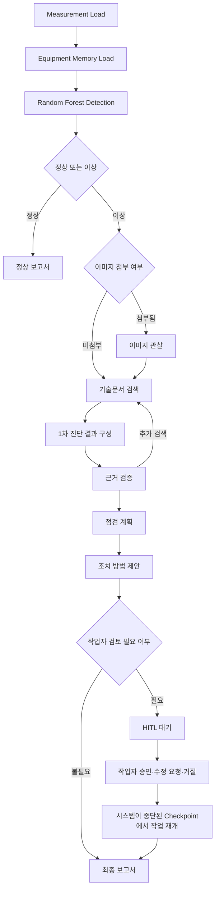

# AI Agent 기술설명서

## 1. Goal

AI Smart Factory Agent Office는 저장된 베어링 Measurement를 분석해 정상·이상 상태를 판별하고, 이상 경로에서는 승인된 기술문서 Evidence를 이용해 이상 원인 진단 결과, 점검 계획, 조치 방법 제안, Final Report를 만드는 의사결정 지원 Agent입니다. 설비 자동제어는 수행하지 않습니다.

## 2. Workflow

실제 graph는 `backend/app/agent/graph.py`의 25개 Backend node로 구성되고, Frontend는 이를 사용자용 13단계로 묶어 표시합니다.

## 3. AI

- ML: `bearing_rf_binary_v1`, `RandomForestClassifier` v1.0
- Input: `vibration_1`, `phase_current_1`, `phase_current_2`에서 추출한 36개 Feature
- RAG: 기술문서 15개를 183개 문서 조각으로 나누고, 각 조각을 384개의 숫자 특징으로 변환해 서로 비슷한 문서 조각을 찾습니다. Chroma `bearing_v1`과 HashingVectorizer를 사용합니다.
- Reasoning: 구조화된 Evidence를 사용하는 결정론적 diagnosis/evidence verification/action planner
- Vision: 이미지 품질과 관찰 가능성만 기록하는 `pillow-quality-observer-v1`; 고장 판독 모델이 아님

RAG는 입력 상태와 관련된 기술문서를 검색하고, 검색된 근거를 진단에 활용하는 절차입니다. 384개의 숫자 특징은 문서 조각 간 유사도를 비교하기 위한 표현이며, 문장의 의미를 깊게 이해하는 Semantic Embedding Model은 아닙니다. 검색 성능은 관련 근거가 상위 5개 결과 안에 포함되는 비율인 Hit@5가 0.913, 관련 근거가 검색 결과 앞쪽에 나타나는 정도를 나타내는 MRR이 0.862입니다. 두 지표 모두 1에 가까울수록 좋습니다.

현재 핵심 경로는 외부 LLM API를 호출하지 않습니다. 모델 지표 1.0은 대표 subset 내부 결과이며 unseen-bearing 성능이나 현장 정확도 100%를 뜻하지 않습니다.

KAMP CNC 확장 검증에서는 1,085개 Data를 대상으로 별도 Data 입력과 기술문서 검색을 확인했으며, 해당 범위의 29개 테스트를 모두 통과했습니다. CNC Data에 대한 ML 성능은 검증하지 않았습니다.

## 4. Tool / API / Data

| 구분 | 실제 연결 |
|---|---|
| Data Tool | Paderborn MAT Adapter와 Measurement Preview API |
| ML Tool | Feature Pipeline과 model registry/inference service |
| Knowledge Tool | purpose별 QueryBuilder, Chroma retrieval, `EvidenceObject` 변환 |
| Memory Tool | 설비 이력 저장(Equipment Memory) read/write와 Run History |
| Human Tool | Human Request, `/human-input`, LangGraph interrupt/resume |
| Observation Tool | 선택형 inspection image 저장과 quality observation |
| Feedback Channel | 순서가 기록된 AgentEvent와 SSE 재연결 |

현재 데이터는 K001, KA01, KI01의 240개 저장 Measurement입니다. AgentEvent는 AI Agent의 작업 단계와 상태 변화를 기록한 이벤트입니다. 서버가 이 이벤트를 브라우저에 새로고침 없이 실시간으로 보내는 방식인 SSE(Server-Sent Events)를 사용하여 검색·진단·승인 대기·완료 등 현재 작업 흐름(Workflow) 상태를 화면에 표시합니다. 이는 실제 Sensor Streaming이 아닙니다.

## 5. Memory

- Run/Event DB: 실행 상태, 순서화 이벤트, Human Request 결과
- LangGraph Checkpoint: `run_id`와 같은 thread ID로 중단·재개 상태 보존
- Equipment Memory: 완료된 분석·진단 결과와 명시적으로 제출된 설비 이력 저장
- Vision DB: 이미지 metadata와 observation 저장

기술문서 RAG와 Equipment Memory는 서로 다른 저장소와 목적을 사용합니다. History 조회만으로 Workflow나 Memory가 다시 생성되지 않습니다.

## 6. Feedback

Evidence가 불충분하면 제한된 횟수로 Query refinement, counter-evidence 검색 또는 추가정보 요청을 수행합니다. 중요 조치는 Workflow를 `WAITING`으로 전환하고, 작업자가 승인·수정 요청·거절을 선택한 뒤 시스템이 중단된 Checkpoint에서 작업을 이어서 수행합니다. 모든 상태는 SSE를 통해 UI에 표시됩니다.

## 7. Existing Assets / New Development

### Existing Assets

Paderborn Dataset, Paderborn/SKF 기술문서, Python/FastAPI/scikit-learn/LangGraph/Chroma/SQLite, Next.js/React/TypeScript를 사용합니다.

### New Development

Measurement Adapter/Replay, 36-Feature 연동, model registry/inference, Knowledge manifest와 Evidence pipeline, LangGraph Workflow, 이상 원인 진단·근거 검증·점검 계획·조치 방법 제안, HITL resume, Equipment Memory, Run History, SSE, Agent Office 및 투명성 화면을 본 프로젝트에서 구현했습니다.

세부 출처와 사용조건은 [SOURCES_AND_AI_USAGE.md](SOURCES_AND_AI_USAGE.md), 검증 결과는 [TEST_RESULTS.md](TEST_RESULTS.md)를 참조합니다.
